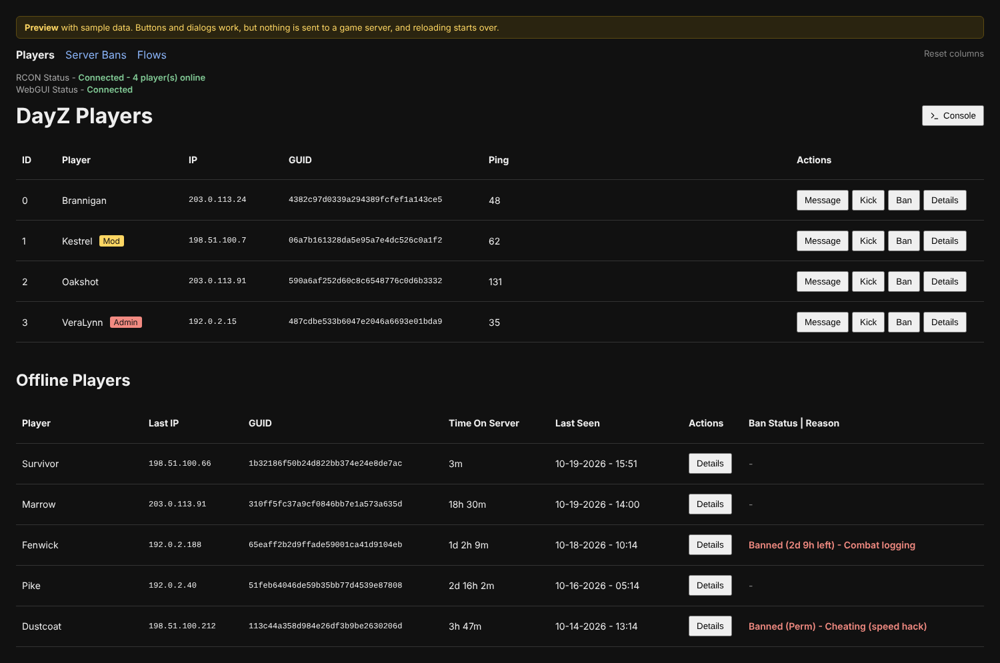
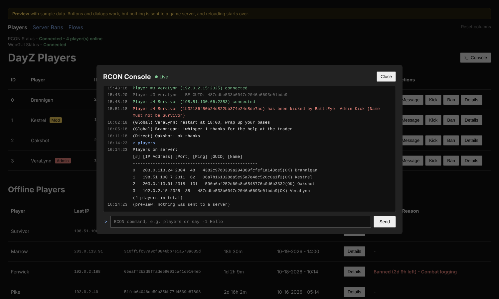
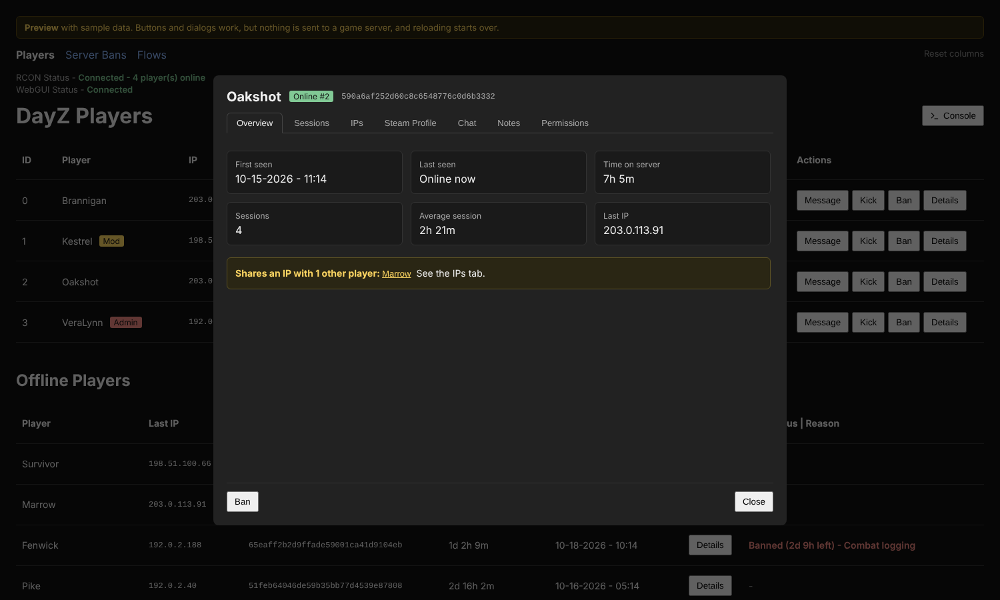
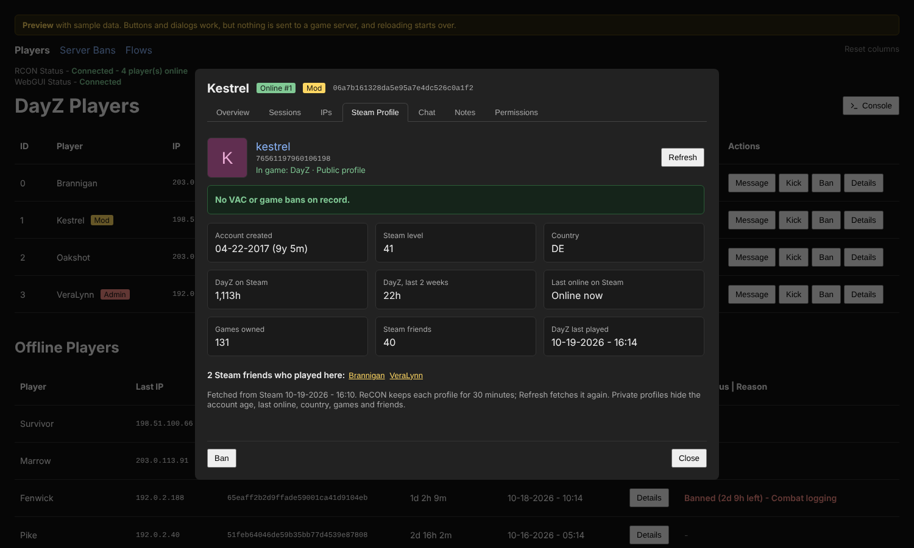
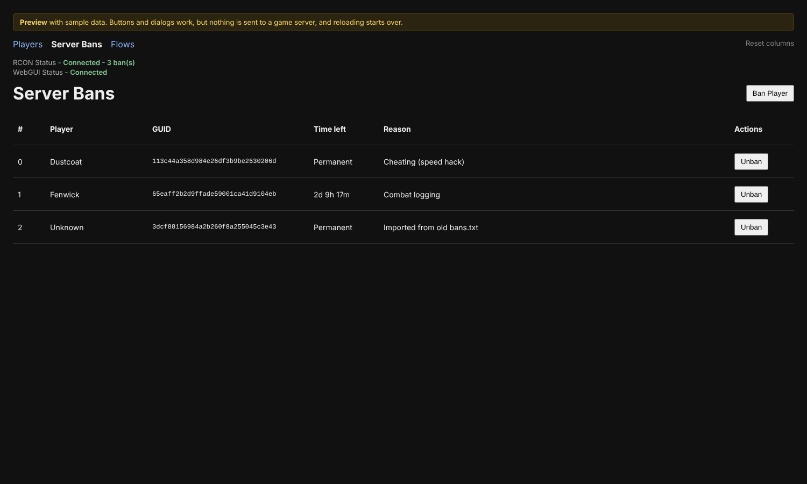
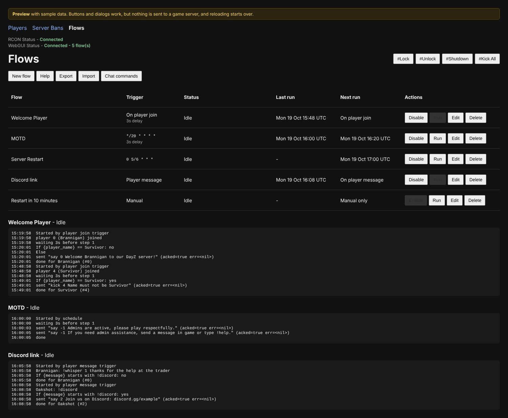
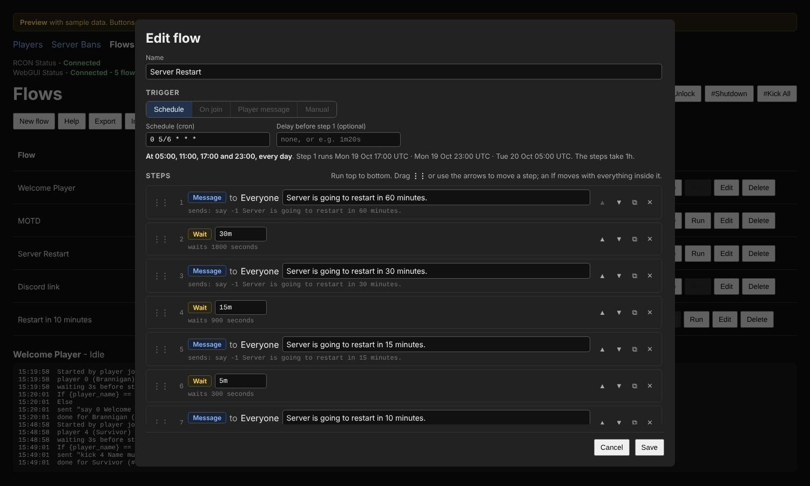
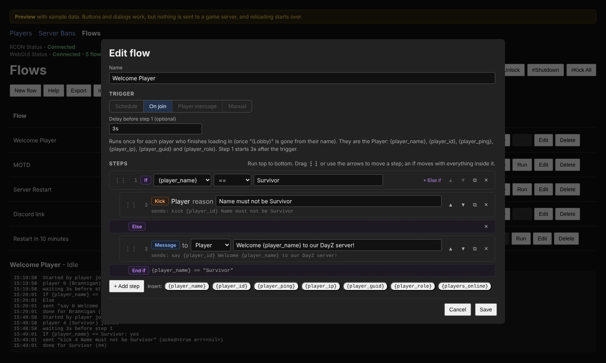
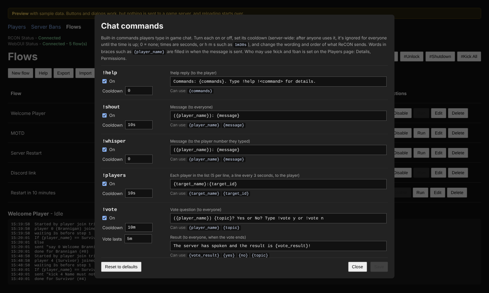
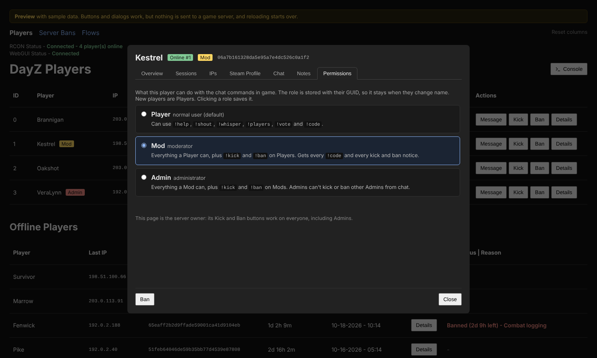

# ReCON

ReCON is a web admin panel for DayZ servers, built on BattlEye RCON. It runs in a small Docker container next to your game server and gives you:

- **A web GUI** for players, bans and automated flows: live player list, per-player history, Steam profiles, a live RCON console and a ban manager.
- **Flows**: restart countdowns, welcome messages, chat replies and more, built from steps in the browser, without writing any script.
- **In-game chat commands** such as `!help`, `!vote` and `!kick`, with Player, Mod and Admin roles.
- **An HTTP API** that any script or task scheduler can call, and a **command-line RCON tool** inside the container.



**Try it without a server:** [`docs/preview`](docs/preview/) has the real pages with sample data built in. Open `docs/preview/players.html` in a browser (from a downloaded copy of the repo, or wherever the `docs` folder is served). Every button and dialog works, but nothing is sent anywhere.

> **No authentication.** Anyone who can reach ReCON's port can run any RCON command on your server. Keep it on a trusted network or behind a reverse proxy with its own login, and never expose it directly to the internet.

## Contents

1. [Install and run](#1-install-and-run)
2. [Configuration](#2-configuration)
3. [The web GUI](#3-the-web-gui)
4. [Flows](#4-flows)
5. [Chat commands and roles](#5-chat-commands-and-roles)
6. [Steam profiles](#6-steam-profiles)
7. [Command line](#7-command-line)
8. [HTTP API](#8-http-api)
9. [Development](#9-development)

---

## 1. Install and run

### Requirements

- Docker with Docker Compose
- A DayZ server with BattlEye RCON turned on: `RConPassword` and `RConPort` set in `BEServer_x64.cfg`
- ReCON doesn't have to run on the same machine as the game server. It only needs to reach the RCON UDP port.

### docker-compose.yaml

Clone this repo, then put a `docker-compose.yaml` next to it (or use the one in the repo as a starting point):

```yaml
services:
  recon:
    container_name: recon
    build: ./recon                      # the folder this repo is cloned into
    restart: unless-stopped
    user: "${PUID:-1001}:${PGID:-1001}"
    environment:
      TZ: America/New_York
      RCON_HOST: 192.168.1.10           # Your DayZ Servers Local IP address
      RCON_PORT: "2305"                 # Your DayZ Server's RCON Port
      RCON_PASSWORD: ${RCON_PASSWORD}
      STEAM_API_KEY: ${STEAM_API_KEY}   # optional, see Steam profiles
      STEAM_SEARCH_MODE: "manual"
      STEAM_SEARCH_CORES: "2"
      STEAM_SEARCH_PRIORITY: "medium"
      MAXMIND_ACCOUNT_ID: ${MAXMIND_ACCOUNT_ID}     # optional, country flags (see below)
      MAXMIND_LICENSE_KEY: ${MAXMIND_LICENSE_KEY}
    volumes:
      - ./data:/data
    ports:
      - "8080:8080"
```

Put the secrets in `.env`, next to `docker-compose.yaml`:

```env
RCON_PASSWORD=your-rcon-password
STEAM_API_KEY=your-steam-web-api-key
MAXMIND_ACCOUNT_ID=123456
MAXMIND_LICENSE_KEY=your-maxmind-license-key
```

### Build and start

```bash
docker compose up -d --build
docker logs -f recon
# listening on :8080 -> RCON 192.168.1.10:2305
# rcon: logged in
# [web] > #unlock (login, acked=true)
```

Then open `http://<host>:8080` (it goes to the Players page).

### More than one DayZ server

Run one ReCON container per game server. Copy the service and give each copy its own service and container name, `RCON_PORT`, password, data folder and host port. Each container keeps its own database.

### With recon-mod

[ReCON-Mod](https://github.com/MowMdown/ReCON-Mod) is a DayZ server-side mod that sends ReCON every player's live state (position, health, stats) every second and runs actions on them and on the weather and time. ReCON shows it on the [Live Map](#live-map-live) page. Install the mod on the game server (see its README). The ReCON image carries the recon-mod it needs and puts it in its data folder as `@ReCON` on start (on Unraid, for example `/mnt/user/appdata/recon/<server>/@ReCON`), replacing it whenever a ReCON update needs a newer one: copy that folder to the game server. ReCON needs nothing more, but for the map's terrain put its pictures in the data folder's `maps` folder (see [Map pictures](#map-pictures)).

The published images `:mod` and `:testing-mod` (and `:v1.2.0-mod`) are the same as `:latest` and `:testing`: they were a separate build with the Live Map in, which every image has now.

### Updating

The Go code is compiled into the image, so pull the new code and rebuild:

```bash
docker compose up -d --build
```

If it still seems to run the old code, force a clean build:

```bash
docker compose build --no-cache && docker compose up -d
```

---

## 2. Configuration

Everything is set with environment variables.

| Variable                | Default            | Description |
| ----------------------- | ------------------ | ----------- |
| `RCON_PASSWORD`         | none               | BattlEye RCON password. Needed unless you enter one in **Settings** on the Players page |
| `RCON_HOST`             | `127.0.0.1`        | IP or hostname of the DayZ server |
| `RCON_PORT`             | `2306`             | BattlEye RCON UDP port (`RConPort` in `BEServer_x64.cfg`) |
| `LISTEN_ADDR`           | `:8080`            | Address the web server listens on inside the container |
| `DB_PATH`               | `/data/players.db` | The SQLite database: players, sessions, IPs, chat, notes, roles, permanent bans, flows and settings (timed bans and RCON Settings are kept in memory only) |
| `TZ`                    | `UTC`              | Time zone for flow schedules and the times shown, e.g. `America/New_York` |
| `STEAM_API_KEY`         | none               | Turns on the full Steam Profile tab. Free at [steamcommunity.com/dev/apikey](https://steamcommunity.com/dev/apikey) |
| `STEAM_SEARCH_MODE`     | `manual`           | How SteamIDs the steam2guid table can't answer are searched for (the table, if you have one, is always read first, as soon as a player joins). `manual`: when you press **Search Steam ID**. `auto`: by itself, in one search for everyone waiting, starting 60s after the first join (+30s per join, at most 3 minutes or 15 players). Either way a search covers every player still missing a SteamID |
| `STEAM_SEARCH_CORES`    | `1`                | CPU cores a SteamID lookup may use (capped at the cores available) |
| `STEAM_SEARCH_PRIORITY` | `medium`           | How much of each core it uses: `low` 33%, `medium` 66%, `high` 99% |
| `MAXMIND_ACCOUNT_ID`    | none               | With `MAXMIND_LICENSE_KEY`, turns on the country flags next to IPs (below). Both are on your free [MaxMind](https://www.maxmind.com/en/geolite2/signup) account's *Manage License Keys* page |
| `MAXMIND_LICENSE_KEY`   | none               | MaxMind licence key, for downloading the GeoLite2-City database |
| `GEOIP_DIR`             | the folder `DB_PATH` is in | Where `GeoLite2-City.mmdb` is kept |
| `QUERY_PORT`            | `27016`            | The server's Steam query port (`steamQueryPort` in `serverDZ.cfg`), for the Server Info page. The query goes to the RCON host (`RCON_HOST`, or RCON Settings) |
| `SERVER_TIME`           | `SystemTime`       | Your `serverTime` from `serverDZ.cfg`: `2000/8/31/06/00` (YYYY/MM/DD/HH/MM) or `SystemTime`. Its date and the map's latitude give sunrise and sunset on the Server Info page |
| `SERVER_LATITUDE`       | the map's (45 when unknown) | The map's latitude in degrees north, for sunrise and sunset on a map ReCON doesn't know (it knows Chernarus) |

`RCON_HOST`, `RCON_PORT` and `RCON_PASSWORD` are the defaults: **Settings** on the Players page can override any of them without editing `docker-compose.yaml` (see below).

Mount `/data` as a volume, or everything ReCON has recorded is lost when the container is recreated. The container runs as UID 99 / GID 100, so the data folder must be writable by that user.

---

## 3. The web GUI

Every page shows two status lines at the top:

- **RCON Status:** whether ReCON can reach the game server (it reads the player list every 5 seconds and sends a heartbeat every 30, or every 5 once a check goes unanswered; three checks missed in a row means unavailable): *Connected*, *Unavailable - Retrying...* with a small grey countdown to ReCON's next try, or *Connecting - Waiting for the server...* (in yellow) once ReCON has sent its login and is waiting for the answer. While the server is unavailable, ReCON only sends the heartbeat, every 5 seconds. It sends **one** login, once the server's port is open again, and waits for the answer: a restarting server can take a minute or more to answer it, and every extra login would show up as another RCon admin login. As soon as the answer comes, the status turns *Connected*. [How ReCON logs in again after a restart](docs/rcon-login.md) has the full sequence as a flow chart.
- **WebGUI Status:** whether your browser can reach ReCON. While it can, the page's count follows *Connected*: players online, bans or flows.

On the Players and Server Bans pages you can drag table headers to reorder the columns; **Reset columns** puts them back.

The picker at the top right sets the look: **Default** (the plain look, what a browser starts with), **Terminal** (green monospace) or **Tokyo Night**. Your browser remembers the choice. The icons ([Phosphor](https://phosphoricons.com), MIT) are built into ReCON, so they work without internet. The fonts (Inter, JetBrains Mono) come from Google Fonts; without internet the pages use the system's fonts instead.

### Server Info: `/server`

The page ReCON opens on. Every 5 seconds ReCON asks the game server what it tells Steam's server browser (the query port, `QUERY_PORT`), so it shows the same things a server list does, and adds what ReCON has recorded itself:

- **The server:** name, map, 1PP or 3PP, version, BattlEye, and whether it is answering (a red dot and "Not answering" when it isn't, with the last answer still shown).
- **Players** and the queue, **in-game time** with the day and night speeds (☀ ×2, and ☾ ×8: the night speed is the day speed times `serverNightTimeAcceleration`) and **uptime** over the last 7 days (of the time ReCON was running).
- **Day & night:** a bar of the 24 in-game hours (marked every hour, labelled every 4) with sunrise, sunset and the current time; how long until sunset and sunrise in real time, and how long a day and a night last. Beside it, a **sky** dial: the sky's colour follows the sun's height (night blue, an orange glow at dawn and dusk, daylight blue); the sun and moon go round one path, opposite each other, crossing the horizon at sunrise and sunset, the path as high as the sun gets at noon on that date at that latitude (low in winter and far from the equator, high in summer); the sun fades out at night as the moon fades in, and stars fade in. South of the equator it is mirrored (east on the right). When the in-game time changes, the bar's marker and the sky glide to it over a second (a jump of over 2 game hours, such as a restart, snaps). DayZ multiplies the night speed by the day speed, so a 10-hour night at ×2 and ×4 lasts 1h 15m. Sunrise and sunset are worked out from the date in `SERVER_TIME` (as in `serverDZ.cfg`) and the map's latitude, with the standard sunrise equation; the in-game date moves on as days pass, but sunrise only shifts a few minutes a week. For a map other than Chernarus, set `SERVER_LATITUDE` (it defaults to 45°N). Near the poles it shows midnight sun or polar night.
- **Population:** players online over the last 12 hours, day, 7 days, 30 days or all time (12h, 1d, 7d, 30d, All), as a smooth line through the most players online in each short slice of time, with the peak, average, different players and sessions over 7 days. It comes from the session history, so it is exact, and it has history from the first day ReCON recorded. Sessions of a minute or less (a failed join, a quick reconnect) don't count, here or in Peak hours.
- **Peak hours:** the average number of players for each weekday and hour over the last 4 weeks, in your browser's time zone.
- **Mods:** the server's Workshop mods, each linking to its Workshop page, and the total download size. ReCON asks Steam every 3 hours when each was last updated; a mod Steam has updated since glows red. Click it to acknowledge the update and it goes back to normal. A mod seen for the first time counts as up to date.

The page is live: ReCON asks the server every 5 seconds and the page updates as often; the graphs every minute.

**Settings** (under the title) sets the same things as the container's `QUERY_PORT`, `SERVER_TIME` and `SERVER_LATITUDE`. Empty fields use the container's values, shown greyed out. The query always goes to the RCON host. **Save** checks the values (nothing changes if one is wrong), keeps them in the database so they survive restarts, and asks the server at once: the top of the dialog says whether it answers on that port.

### Players: `/players`

The top table lists the players online now (refreshed every 5 seconds). ReCON follows who connects and disconnects from the server's own messages, and also asks the server for the player list every 5 seconds, for up-to-date pings and anyone whose disconnect it missed. Mods and Admins have a badge after their name. **Last Message** shows the newest thing each player has written in chat since they connected (hover for the channel, time and full text). It's empty until they chat; messages sent to them aren't shown there, only in their chat history.

| Button  | What it does |
| ------- | ------------ |
| Message | Opens that player's conversation: their chat, the private messages ReCON sent them, and a box to send another |
| Kick    | Kicks them with the reason you type |
| Details | Opens everything ReCON has recorded about them (below), including **Ban** |

**Offline Players** lists everyone who has played before and isn't banned (banned players are on the Server Bans page): last IP, total time on the server, when they were last seen, and **Last Message**, the newest thing they wrote in chat, from their chat history (hover for the channel, time and full text). If the game server stops answering, this list still shows from the database.

**Settings** (under the title, on the left) changes where ReCON connects: Server IP, Port and RCON password. The line under the title shows the server in use: *Connected to IP:PORT* in green, or *Can't reach IP:PORT* in red. A field left empty uses the default from `docker-compose.yaml`, shown greyed out; clear the fields and Connect to go back to those defaults. **Connect** tries one login with those settings on a new connection each time it's pressed, even if nothing changed. Only if the server accepts the login does ReCON switch to it and keep the settings, so a typo can't cut ReCON off; otherwise nothing changes and the dialog says why. The settings are kept in memory only: restarting ReCON goes back to the `docker-compose.yaml` values, which the command-line tool always uses.

**Console** (under the title, on the right) opens ReCON's console log: everything the server reports (connects, disconnects, GUIDs, chat, kicks, admin logins) and every command ReCON sends for the pages, flows and chat commands, with the server's reply, as it happens. It runs any command you type exactly as typed; Up and Down recall earlier commands. ReCON keeps the last 10,000 lines until it restarts and shows the newest 1,000. The routine checks (heartbeats, player and ban list reads) aren't logged. The container log has the same lines, marked `[web]`, and also notes who sent each command (a flow's name, a page, a chat command); the command-line tool's are marked `[cli]` and aren't in the console.



Every IP on the page (the online and offline lists, and in Details the last IP, sessions and IPs) has its country's flag to its left; hover it for the country's name. The flags need MaxMind's free GeoLite2-City database (about 60 MB): with `MAXMIND_ACCOUNT_ID` and `MAXMIND_LICENSE_KEY` set, ReCON downloads it to `GEOIP_DIR` when it starts if it isn't there, and again when it is a week old (MaxMind updates it twice a week). Without them nothing is downloaded and there are no flags, unless you put `GeoLite2-City.mmdb` in that folder yourself. A `GeoLite2-Country.mmdb` left there by an older ReCON still gives the flags (but no maps) until the City one is downloaded. Private and LAN addresses have no country, so no flag.

#### Details

Details works for online and offline players. **Prev** and **Next** in its top right corner go through the players in the page's order, online players by number, then offline ones by name, and wrap around at either end. It has these tabs:

| Tab           | Shows |
| ------------- | ----- |
| Overview      | First and last seen, total time, sessions, average session, last IP, ban status, and a warning when the player shares an IP with anyone else |
| Sessions      | Each visit: connected, disconnected (noted when they were kicked or banned), duration and IP. A player back from the same IP within 5 minutes of ReCON logging in again after a server restart keeps the same session, including players the restart itself disconnected (a `#shutdown` or Kick everyone in the 2 minutes before), unless they were banned; the time they were away doesn't count. Back from another IP, they get a new session |
| IPs           | Every IP they used, and anyone else seen on the same IP. Names are links to that player's details. Click an IP with a location to open a map under it: where GeoLite2-City puts the IP (where it is registered, not the player's address), with a circle for how accurate that is, the city and region, and a link to OpenStreetMap. The map's tiles come from OpenStreetMap, so your browser needs internet for them; the place shows without |
| Steam Profile | Their Steam account (see [Steam profiles](#6-steam-profiles)) |
| Chat          | Their chat history. While they're online you can message them from here |
| Notes         | A private admin note of up to 500 characters. It saves when you close the dialog or switch players |
| Role          | Their role for the chat commands: Player, Vehicles, Mod or Admin. Clicking a role saves it |
| Danger        | **Delete Player** (below) |

The **Ban** / **Unban** button at the bottom works whether the player is online or not.

On the **Danger** tab that button is **Delete Player**: it removes the player and everything ReCON has recorded about them from the database (sessions and playtime, IPs, chat history, the note, their role and SteamID). It asks *Are you sure?*, then for the player's name, typed exactly, before **Delete** does it. It can't be undone. A ban stays on the server's ban list, and a player who joins again starts over as a new player. A player can only be deleted while offline.

| Overview | Steam Profile |
| :---: | :---: |
|  |  |

### Server Bans: `/bans`

Lists the server's GUID bans with the player's name, time left and reason, refreshed every 10 seconds. A GUID ReCON has never seen shows as *Unknown*. **Unban** removes every entry for that GUID and saves the ban file.

The list follows the server's ban list: ReCON reads it when it logs in to RCON (so after every server restart) and every 5 minutes. A ban added on the server some other way shows up at the next read. **Permanent** bans are stored in ReCON's database and only leave through **Unban** here: if one goes missing from the server's list, ReCON adds it back. **Timed** bans are kept in memory only, since the server already has them; a timed ban leaves the list when its time runs out, as it does on the server, and after ReCON restarts they come back with the first read.

**Ban Player** (top right) bans anyone who has ever played on the server, online or not. Pick them by name (online players are marked, and the start of the GUID tells apart players with the same name), enter a reason (the player sees it), and leave the duration at **0 for permanent** or enter minutes. An online player is kicked straight away.

**Export** and **Import** move **permanent** bans between servers as a `bans.json` file; timed bans stay with the server that placed them. Both list the bans as *Name - GUID* with a checkbox each (and **Select all**). Export starts with every permanent ban ticked and saves the ticked ones. Import reads a file and ticks every ban in it except ones it can't add, which are greyed out with the reason (*already banned*, *not a valid GUID*); the ticked ones become permanent bans here, go on the server's ban list (when the server isn't answering, as soon as ReCON next connects), and anyone online among them is kicked. A ban with no name or reason in the file is added as *Unknown* / *Imported ban*.



### Flows: `/flows`

See [Flows](#4-flows) below. **Commands** (right of the buttons above the list) opens a dialog with **Lock server** (`#lock`), **Unlock server** (`#unlock`), **Kick everyone** (`kickall`) and **Shut down server** (`#shutdown`). Picking one sends it straight away, and the result shows just above the button. Kick everyone and Shut down ask you to confirm first.

### Developer: `/developer`

A page for troubleshooting. No menu item links to it: type `/developer` after the address. Anyone who can open the web GUI can open it. The list on the left is every player, with a search (name, GUID, any IP they used, SteamID) and All / Online / Offline / Banned filters. Pick one to see everything ReCON holds about them, raw and untrimmed, in sections you can fold:

- **flow**: what each [placeholder](#placeholders) would be for them right now, and where it is read from.
- **memory**: the player tracker's entry (online, or held over a server restart), the online list as the pages see it, each flow's current or last run, a timed ban, and the ban list's state.
- **db**: every row of every table in `players.db` for their GUID: `players`, `active_sessions`, `session_history`, `player_ips`, `chat_messages`, `player_notes`, `bans`.
- **ext**: the Steam cache (profile, ban record, SteamID search) and GeoIP's country for each of their IPs.

**Copy all as JSON** copies the lot. The page only reads and never asks Steam for anything. It doesn't refresh by itself, so nothing moves while you read: **Refresh** reads the list and the player again. Linking to `/developer#<guid>` opens that player.


### Live Map: `/live`

It shows what [recon-mod](#with-recon-mod) sends; without the mod running on the game server, it says "recon-mod isn't connected".

- **Left:** every online player, with their map grid square, what's in their
  hands or the vehicle they're in, a health bar, and chips for bleeding,
  illness, knocked out and restrained. A search box filters the list.
- **Right:** the map, with each player as an arrow showing their heading,
  updated every second. Drag to pan, scroll to zoom; **Fit** shows the
  whole map, **Fill** zooms until its width fills the view, edge to edge; **Full screen** makes the map fill the browser's window (Esc puts it back). **Overlays** (top left) opens the layers to show, each remembered in this browser, drawn with players on top, then vehicles and predators, town names, events and deaths, and the grid. **Players** (on unless switched off) shows the players' arrows and names. **Grid** (on unless switched off) shows the 1 km lines, in the theme's border colour lit with its accent, and their numbers. **Vehicles** shows every car, motorbike and boat on the server, pointing the way it faces: blue with someone in it, green with its engine running. It needs recon-mod 0.0.1i or later. Clicking one shows where it is, its condition, fuel, who is in it and whether its engine runs; **Info…** opens its parts, damage zones (engine, fuel tank, body...) and cargo side by side, each with its condition (read from the mod when it opens; **Refresh** reads them again). **Delete** (in Info, or the right-click menu) removes it and everything in it, after you confirm; not while anyone is in it. **Towns** shows the map's place names (from the map's own config, sent by recon-mod 0.0.1i on), bigger for bigger places: zoomed out only the cities, closer the villages, then the smaller places. **Events** shows helicopter crashes and toxic zones (static, from an airstrike or a grenade; a circle as wide as the zone), updated every 10 s. **Predators** shows the bears, wolves and guard dogs alive on the server, each named (Bear, Wolf, Dog) beside a dot pointing the way it faces, updated every 2 s (recon-mod 0.0.1l on); hover the button for how many of each. **Right-click** a player for their tabs (Open, Inventory, Spawn an item), **Follow Player** (the map keeps them in the middle until you drag it or click the Following chip), **Teleport to…** (your next click on the map teleports them there; Esc cancels), Heal, Dry, Message and Kill; a vehicle for Info, Follow, teleporting a player beside it, and Delete. **Right-click** the map for that spot's position, to teleport any online player there, to spawn an item there (a search over every item the server has, vehicles whole; recon-mod 0.0.1j on; animals from 0.0.1k, with an A-Z bar to jump to a letter); the position at the top can be selected to copy it. **Deaths** puts a red X where each player died in the time picked beside it (the last hour to 30 days): hover one for who, how and when. It is a 1 km grid with the map's coordinates, over the
  map's picture if there is one ([Map pictures](#map-pictures)). Above
  the map, beside **Time & Weather**: the weather and the in-game time.
- **Clicking a player** opens a popup on the map with their health, blood, water and food, whether they're bleeding or in a vehicle, and what they wear and hold (read from the mod while it's open; more than 5 scroll). **Info** opens their dialog, **Teleport** moves them to the next place you click on the map, and **Spawn** opens their Spawn item tab. In the dialog, drag Health, Blood, Water, Food or
  Comfort left or right to set it (shock, stamina and temperature are read
  only). They show health, blood, water and food in
  DayZ's HUD colours (white, yellow, red, blinking red at the same
  thresholds as the game), shock, stamina, temperature (the game's hot and
  cold colours) and comfort (the heat buff, with its +/++/+++ stage and the
  most their clothes allow), conditions with **Heal** and **Dry** (them and everything they carry) beside them, a
  mini-map of the 1 km around them, what's in hand, vehicle, kills and
  deaths, and the actions: Teleport (to X and Y or a mini-map click,
  this player to another, or another to this player; the button stays
  grey until there's somewhere to go; **Previous** sends them back) and a message box. Each action's result shows below
  them. The other tabs: **Inventory** (every equipment slot is always
  listed, *Empty* when there's nothing in it; an item's condition can be set: pristine, worn, damaged, badly damaged or ruined), **Spawn item** (every item the server
  has loaded, on the ground in front of them, into their inventory (what
  doesn't fit goes on the ground) or into their empty hands; and its
  vehicles, modded ones too, which come whole with their parts and full
  fluids, one at a time, 8 m in front of them; the list fits the dialog's
  height) and **Kills & deaths**, the latest 100 they were in
  (when, who with what and how far, and where), with their all-time
  totals, and **Kill**. Each death says what killed them (a player, an infected, an
  animal, the environment: a fall, fire, drowning, cold, a vehicle, an
  explosion or a trap; an ailment: bleeding out, thirst, hunger or
  illness; a suicide or ReCON's Kill), with buttons to show only one kind.
  That needs recon-mod 0.0.1h or later; older deaths say only who killed
  them.
- **World…** sets the in-game date and time, freezes the clock, and sets the
  weather: overcast, rain, fog, snow, wind speed and direction, and
  lightning, with presets (Clear, Cloudy, Rain, Thunderstorm, Fog, Snow),
  over how many seconds the change happens and how long it holds; whether
  the weather follows the map's rules, only what was set, or is frozen; and
  the overcast range rain falls in.

While the mod is connected, ReCON's Server Info page takes the in-game date
from it (for sunrise and sunset) rather than from `SERVER_TIME`.

#### Map pictures

The page draws a 1 km grid with the map's coordinates; to draw the terrain under it, put the map's picture in the data folder's `maps` folder (with Docker, the `maps` folder next to the database): `maps/<world>.jpg` (or `.png`, `.webp`; square, north up) and its tiles, `maps/<world>/`. `<world>` is the world name the mod reports (`chernarusplus`, `enoch`, `sakhal`, `namalsk`, ...). The pictures come from the game's or the map mod's files, so they can't be shared: [satmap](https://github.com/MowMdown/satmap) makes them from your own copy of the game. Use one only if you have the right to: many DayZ map images online belong to their makers.

The tiles are levels: `maps/<world>/0/` is the whole map in one tile, each level after it has twice the columns and rows (`<column>_<row>.jpg`, column 0 at the west edge, row 0 at the north) and the last has the picture's own pixels; `maps/<world>/tiles.json` (`px`, `tile`, `levels`, `ext`) describes them. Whatever the zoom, the page loads only the few tiles in view, from the least detailed level sharp enough, and draws a coarser one under any still loading. When there are tiles it never loads `maps/<world>.jpg`: a big whole picture (15360 px is about 1 GB once a browser decodes it) can crash the page, on a phone especially.

**Calibrating.** If players aren't drawn where they are on the picture, calibrate it: stand somewhere you can pick out on the picture (a crossroads, a pier), open yourself on the Live Map, click **Calibrate** on the mini-map and click where you really are. One point moves the picture; do it again at a second spot 1 km or more away (the farther the better, such as across the map) and it is resized too. Calibrating near a point replaces it, and **Reset** (shown while calibrating) forgets them. The points are saved in `maps/<world>/calibration.json`, so the `maps` folder must be writable by ReCON (user 1001 in the container; don't mount it `:ro`). Re-slicing the map with satmap keeps the file, and it still fits: the points are where on the picture, not which tile. With several servers sharing one `maps` folder, each calibrates its own map. A picture within 2% of the map's size is taken as 1 px a metre from the map's north-west corner until it is calibrated (Deer Isle's picture is 16512 px for its 16384 m), any other is stretched over the whole map.

The HUD colours and thresholds for health, blood, water, food and temperature are DayZ's, from its scripts (Bohemia Interactive, [DayZ Public License](https://www.bohemia.net/en/licenses/dayz-public-license-dpl)).
---

## 4. Flows

A flow is a list of steps ReCON runs for you: send a message, wait, lock the server, kick a player, and so on. Steps run from the top down. Only **Wait** takes time; everything else goes out straight away.



| Button           | What it does |
| ---------------- | ------------ |
| Enable / Disable | Turns the trigger on or off. Schedule, On join and Player message flows start disabled |
| Run / Stop       | Starts a Schedule or Manual flow now, or stops a running one |
| Edit             | Opens the flow editor |
| Delete           | Deletes the flow (stop it first). This is the only action that asks first |
| New flow         | Creates a flow |
| Help             | The full guide: steps, placeholders, If / Else, triggers, cron and chat commands |
| Export / Import  | Save flows to `flows.json`, or add flows from a file. Both list the flows with a checkbox each (and **Select all**): Export starts with every flow ticked and saves only the ticked ones; Import adds only the ticked ones, at the bottom, disabled |
| Chat commands    | The [chat command settings](#5-chat-commands-and-roles) |

Drag rows to reorder the list. Each flow's latest run log is shown under the table: every message sent, every If decision, and how the run ended.

### Triggers

| Trigger            | Runs | Needs Enable |
| ------------------ | ---- | ------------ |
| **Schedule**       | On a cron schedule | Yes |
| **On join**        | Once for each player who connects, as soon as they finish loading in | Yes |
| **Player message** | Once for every chat message a player sends, as soon as it arrives | Yes |
| **Manual**         | When you press Run, or call `POST /api/flows/<id>/run` | No |

- Every trigger can have a **delay** before step 1.
- A flow's trigger can't change after it's saved, so a restart flow can never start firing on every join by accident. To change it, make a new flow, or Export, edit `trigger` in the file and Import.
- On join and Player message flows run for one player (who joined, or who typed), so Run can't start them. Several players can be in progress at once; they share one run log and one Stop button.
- Schedules start right on time (plus the delay): ReCON watches the clock rather than checking every few seconds.
- On join flows start for players ReCON sees connecting: ReCON asks the server for the player list every 3 seconds while someone is loading, and the flow starts when *(Lobby)* leaves their name. Players already online when ReCON starts aren't greeted. After a server restart, everyone who reconnects is.

### Times

Every time box (Wait, the delay, chat command cooldowns) takes seconds, or hours, minutes and seconds together: `30`, `90s`, `1m20s`, `2h 15m`.

### Steps



| Step                             | Sends |
| -------------------------------- | ----- |
| Message                          | `say -1 text` to Everyone, or `say <number> text` to the Player |
| Player list                      | The names of everyone online |
| Wait                             | Nothing: pauses before the next step |
| Lock / Unlock / Shut down server | `#lock`, `#unlock`, `#shutdown` |
| Kick / Ban                       | Kicks or bans (by GUID) the Player |
| Kick everyone                    | Kicks every player online |
| If                               | Runs its steps only when its condition is true |
| For each                         | Runs the steps inside it once per player online, or per new chat message, with that player as the Player (see below) |
| Stop flow                        | Ends the run there |
| RCON command                     | Any command, as typed |

Move a step with its arrows, or drag it by the dotted handle on its left. Moving an If moves everything inside it. Anything missing is shown in red under the row.

**When stopped:** Schedule and Manual flows can also have steps that run if someone presses Stop before the run ends, such as *Server restart cancelled.* and Unlock server. They can be any steps, with the same rules as the main steps (a For each with Ifs and Kicks, Waits, and so on); pressing Stop again ends them. **+ Add step** (bottom left of the editor) adds to the main steps; drag a step into When stopped, and back.

### Placeholders

**Values** (next to **+ Add step**) lists them. Type them into a step's text, reason or command; each is filled in when the step runs.

| Placeholder | Is | Works in |
| ----------- | -- | -------- |
| `{players_online}` | How many players are online | Every flow |
| `{player_name}` `{player_id}` | The player's name and number | On join, Player message |
| `{player_ping}` `{player_ip}` `{player_guid}` | Their ping, IP address and GUID | On join, Player message |
| `{player_role}` | Player, Vehicles, Mod or Admin | On join, Player message |
| `{player_vac_bans}` `{player_game_bans}` `{player_days_since_last_ban}` | Their VAC bans, game bans, and days since their last ban on Steam (below). `?` when ReCON has no Steam ban record for them | On join, Player message |
| `{message}` | Everything they typed | Player message |

### If, Else if, Else

An If compares one thing, such as `{player_ping}`, and runs its steps when the comparison is true. **+ Else if** adds more comparisons of the same thing; the first one that's true runs. **+ Else** runs when none are. Ifs can go inside other Ifs. Deleting an If or a For each keeps the steps inside it: they move out one level, where the block was.

| Compare | Operators |
| ------- | --------- |
| `{message}` | **contains** any of the words, or a `"quoted phrase"`, as whole words. **starts with**: the first word is one of the words, so `!discord` matches "!discord please" but not "!discordx". **is exactly**: the whole message is the value. Case is ignored |
| `{player_name}` `{player_ip}` | **is** / **is not** ignoring case, **matches** with `*` wildcards (`*admin*`, `192.168.*`), or **contains** |
| `{player_id}` `{player_guid}` | **is** / **is not** |
| `{player_ping}` `{players_online}` | `=` `!=` `>` `>=` `<` `<=` |
| `{player_role}` | **is**, **is not**, **is at least** or **is at most** Player, Vehicles, Mod or Admin (Player < Vehicles < Mod < Admin) |
| `{player_vac_bans}` `{player_game_bans}` `{player_days_since_last_ban}` | `=` `!=` `>` `>=` `<` `<=` |

**Steam bans.** `{player_vac_bans}`, `{player_game_bans}` and `{player_days_since_last_ban}` come from the player's ban record on Steam, so they need `STEAM_API_KEY` and the player's SteamID (see [Steam profiles](#6-steam-profiles)). ReCON asks Steam once per player and keeps the answer 30 minutes. When there is no record to compare (no key, no SteamID found yet, Steam not answering), an If on one of them is **skipped**, its Else ifs and Else too, and the run log says so. A player with no bans has no "days since last ban", so an If on it is skipped for them as well. Steam's days count from the last VAC **or** game ban. For example, on an **On join** flow:

- **If** `{player_vac_bans} >= 1`, **If** `{player_days_since_last_ban} < 365`: Kick *VAC ban in the last year*.
- **If** `{player_vac_bans} > 1`, **If** `{player_days_since_last_ban} > 365`: Kick *Too many VAC bans*.

A player whose SteamID isn't known when they join (no steam2guid table, or not in it) has no record until a search finds it, so these Ifs are skipped for them on that join.



### For each

**For each** runs the steps inside it (down to its *End for each*) once per item, with that item's player as the Player. Kick, Ban, a Message to the Player, the `{player_...}` placeholders, `{message}` and If comparisons all work inside it, in any trigger, Schedule and Manual included. Ifs inside decide who or what qualifies, and it acts only when the flow runs, on what happened since the flow's last run (the first run looks at the current sessions so far). Pick what it goes through:

- **player**: every player online (the latest 5-second player check's), one after another. `{message}` is that player's latest chat line since this flow last ran (empty if they haven't chatted since).
- **message**: every chat line that players online sent since this flow last ran, oldest first, with the sender as the Player and the line as `{message}`. A flow every minute sees each line once.

Other rules:

- **Unverified players:** players BattlEye hasn't verified yet are left out.
- **Stop flow** inside it ends the whole run.
- **No nesting:** a For each can't go inside another one.
- **Run log:** lists each player a condition matched, not every one checked.

Chat lines are kept in memory with each online player for their current session (up to 100 each), so they go when the player leaves or ReCON restarts.

For example, Schedule flows every minute (`* * * * *`):

```
For each player
    If {player_ping} > 500
        Kick  the Player, reason "Ping too high ({player_ping})"
    End if
End for each

For each message
    If {message} contains noob
        Message  the Player "Please keep chat friendly"
    End if
End for each
```

In a flow without a player of its own, **Add step** puts an If inside the For each at the end of the list, and Kick, Ban and Message into the innermost block there, so New flow → Schedule → Add step *For each*, *If*, *Kick* builds the first one.

Some examples:

- Schedule: **If** `{players_online} > 0` Kick everyone, **Else** Shut down server.
- On join: **If** `{player_ping} >= 500` Kick, reason *Ping too high ({player_ping})*.
- Player message: **If** `{message}` starts with `!discord`, Message to Player *Join us at discord.gg/...*.

### Schedules

A schedule is a standard 5-field cron expression, `minute hour day-of-month month day-of-week`, in the container's `TZ`. As you type, the editor explains it in plain English and lists the next runs, delay included.

| Cron           | Runs |
| -------------- | ---- |
| `0 6 * * *`    | Every day at 06:00 |
| `0 */6 * * *`  | 00:00, 06:00, 12:00 and 18:00 |
| `0 5/6 * * *`  | 05:00, 11:00, 17:00 and 23:00 |
| `30 4 * * 1,4` | Mondays and Thursdays at 04:30 |
| `0 5 * * 1-5`  | Weekdays at 05:00 |

`*` is any value, `1,4` a list, `1-5` a range and `*/15` every 15th. Months and weekdays also accept names (`jan`-`dec`, `sun`-`sat`); Sunday is 0 or 7.

Whenever ReCON logs in to the game server (on start, and after a server restart), it sends `#unlock` 3 seconds after the login is accepted. A restart flow can therefore lock the server, shut it down and leave the unlock to ReCON.

### Example flows

[`examples/flows.json`](examples/flows.json) has three ready-made flows to Import: a **Welcome Player** greeting (which also kicks anyone still named *Survivor*), an **MOTD** every 20 minutes, and a **Server Restart** countdown with warnings from 60 minutes out. The file format is the same as Export's:

```json
{
  "flows": [
    {
      "name": "MOTD",
      "trigger": "schedule",
      "schedule": "*/20 * * * *",
      "delay": "3s",
      "steps": [
        { "type": "message", "to": "all", "text": "Admins are active, please play respectfully." },
        { "type": "wait", "time": "2s" },
        { "type": "message", "to": "all", "text": "If you need admin assistance, send a message in game or type !help." }
      ]
    }
  ]
}
```

---

## 5. Chat commands and roles

Players type these in game chat. They start with `!` because DayZ drops chat messages that start with `/`.

| Command | Who | Does |
| ------- | --- | ---- |
| `!help` | Everyone | Lists the commands the player's role may use (Players don't see the Mod commands); `!help !vote` explains one |
| `!shout <message>` | Everyone | Sends the message to everyone |
| `!whisper <number> <message>` | Everyone | Private message to that player |
| `!players` | Everyone | Lists everyone online with their number |
| `!vote <question>` | Everyone | Starts a server-wide vote; everyone answers `!vote y` or `!vote n`, and more yes than no passes |
| `!code` | Everyone | Sends the player's code (the last 6 characters of their GUID) to the mods and admins online |
| `!kick <code or number> <reason>` | Mods, Admins | Kicks that player |
| `!ban <code or number> <reason>` | Mods, Admins | Bans that player permanently; by code, even if they've left |
| `!warning <code or number> <reason>` | Mods, Admins | Warns that player (see below) |
| `!car`, `!truck`, `!boat`, `!vehicle <name> [colour]` | Vehicles, Mods, Admins | Spawns that vehicle whole in front of them (needs recon-mod; see below). Alone, lists the names |

- **Code or number:** a player's code is the last 6 characters of their GUID (they can type `!code`); their number is the one `!players` shows (`12` or `#12`).
- **Roles** are set on the Players page, under **Details → Role**, and are stored with the player's GUID, so they survive a name change. Each includes everything below it: **Player** < **Vehicles** (adds `!car`, `!truck`, `!boat`, `!vehicle`) < **Mod** (adds `!kick`, `!ban`, `!warning`) < **Admin**. New players are Players.
- Mods can kick, ban and warn Players and Vehicles players. Admins can also kick, ban and warn Mods. Nobody can kick, ban or warn an Admin from chat. The web GUI's buttons act as the server owner and work on everyone.
- Every mod and admin online is told about each kick, ban and warning. With **Announce** on, everyone is told.
- **Warnings:** each `!warning` is sent to the player with its reason and adds one to their warnings. Warnings are counted per visit: they start again at 0 when the player leaves. The warning that reaches the threshold (**Warnings until**, 2 by default, 1 or more) is followed 5 seconds later by a kick or a permanent ban with that warning's reason, whichever the **Kick / Ban** setting next to it says at that moment, and the count starts again.
- Only a command that works gets a reply. A typo, a cooldown or a missing permission is silently ignored, though the line still appears in the player's chat history. The vehicle commands are the exception: they say why they couldn't spawn one.
- **Vehicles** (`!car olga black`) come from the map's `maps/<map>/vehicles.json` in ReCON's data folder: category (`car`, `truck`, `boat`, `vehicle`), then a short name, then colours, each naming a class:

  ```json
  {"car": {"olga": {"default": "CivilianSedan", "black": "CivilianSedan_Black"}}}
  ```

  No colour picks `default`, or a random colour if there's none. Case never matters. The first time recon-mod connects on a map with no file, ReCON writes one from the server's vehicles: colours grouped by display name, the name's first word as the short name, `boat` and `truck` by class name, DayZ's own five cars under `car`, and everything else under `vehicle`. ReCON never changes the file after that; edit it to rename, move or add vehicles, and the next command uses it. The **Chat commands** dialog lists vehicles on the server that the file doesn't have yet. Without recon-mod, no file is made, `!help` doesn't list these commands, and typing one answers that recon-mod isn't running.

**Chat commands** on the Flows page (a tab for everyone's commands and one for Mods & Admins) turns each command on or off, sets its cooldown and edits the wording of everything ReCON sends. Cooldowns are server-wide: once anyone uses a command, it's ignored for everyone until the time is up.

| Chat command settings | Role |
| :---: | :---: |
|  |  |

---

## 6. Steam profiles

BattlEye only reports a GUID, which is a one-way hash of the player's SteamID. ReCON finds the SteamID by checking Steam account IDs until one matches the GUID. Older accounts are found in seconds; newer ones take longer. Once found, the SteamID is saved with the player, so the lookup only happens once.

- When a player without a SteamID joins, ReCON looks them up in a steam2guid table straight away, if you have one. Anyone it can't answer needs a search, which covers every player still missing a SteamID at once. In the default `manual` mode it starts from the **Search Steam ID** button on a player's Steam Profile tab, which shows its progress. In `auto` mode it starts by itself, a minute after the first such player joins (30 seconds more for each further join, at most 3 minutes or 15 players).
- `STEAM_SEARCH_CORES` and `STEAM_SEARCH_PRIORITY` set how much CPU a lookup may use.

Without `STEAM_API_KEY`, the tab shows only the SteamID and a link to the profile. With a key it also shows:

- VAC and game bans (from any game), community and trade bans
- account age, Steam level, country (its flag and name), and when they were last online
- DayZ hours (total and the last two weeks), and a warning when DayZ isn't in their library, which can mean they're playing on a Family Sharing copy
- games owned, friend count, and which of their Steam friends have played on your server

Profiles are kept for 30 minutes; **Refresh** fetches one again. Private profiles hide most of these.

---

## 7. Command line

The image includes a command-line RCON tool, `recon` (also available as `rcon`). It logs in with the container's settings.

```bash
docker exec recon recon players
docker exec recon recon say -1 "Hello everyone"
docker exec recon recon "#lock"
docker exec recon recon kickall "Server restarting"
```

Interactive mode stays logged in until you type `exit`:

```bash
docker exec -it recon recon -i
rcon> players
rcon> say -1 Restart in 5 minutes
rcon> exit
```

Quote anything that starts with `#`, or the shell treats it as a comment. Use single quotes around messages that contain `!`.

### Common RCON commands

| Command | Effect |
| ------- | ------ |
| `players` | List connected players |
| `say -1 <message>` | Message everyone |
| `say <player#> <message>` | Message one player |
| `kick <player#> <reason>` | Kick one player |
| `bans` | List bans |
| `addBan <guid> <minutes> <reason>` | Ban a GUID (0 = permanent) |
| `removeBan <#>` | Remove a ban by its number in `bans` |
| `#lock` / `#unlock` | Block or allow new connections |
| `#shutdown` | Stop the server |
| `kickall [reason]` | ReCON's own command: kick everyone online |

---

## 8. HTTP API

Every response is JSON. Failed requests return `{"ok": false, "error": "..."}`. The examples use `http://<host>:8080`.

### Run any RCON command

```bash
curl "http://<host>:8080/rcon?cmd=players"                       # GET, URL-encoded

curl -X POST http://<host>:8080/rcon \
  -H "Content-Type: application/json" \
  -d '{"command":"say -1 Restart in 5 minutes"}'                 # POST, JSON

curl -X POST http://<host>:8080/rcon -d '#lock'                  # POST, plain text
```

```json
{"ok": true, "command": "players", "acked": true, "output": "Players on server: ..."}
```

`acked: false` means the server never confirmed it received the command.

### Kick everyone

`POST /kickall` with an optional `{"reason": "..."}` (default `Server restarting`). The `result` lists who was kicked (`order`), kicks the server didn't acknowledge (`unacked`) and anyone still connected (`remaining`).

### Players

| Method | Path | Body | Description |
| ------ | ---- | ---- | ----------- |
| GET  | `/api/players` | | Online players, offline players (banned players left out) and ban statuses |
| GET  | `/api/players/all` | | Every player ever seen, from the database (works while RCON is down) |
| POST | `/api/players/<id>/message` | `{"message": "..."}` | Private message, by player number |
| POST | `/api/players/<id>/kick` | `{"reason": "..."}` | Kick, by player number |
| POST | `/api/players/<id>/ban` | `{"reason": "...", "minutes": 0}` | Ban by GUID (0 = permanent) and kick, by player number |
| GET  | `/api/players/<guid>/details` | | Everything the Details dialog shows |
| GET  | `/api/players/<guid>/chat` | | Chat history, oldest first |
| POST | `/api/players/<guid>/chat` | `{"message": "..."}` | Private message, by GUID |
| POST | `/api/players/<guid>/note` | `{"note": "..."}` | Save the admin note (an empty note deletes it) |
| POST | `/api/players/<guid>/role` | `{"role": 0}` | 0 Player, 1 Mod, 2 Admin |
| DELETE | `/api/players/<guid>` | `{"name": "..."}`, their name exactly | Delete the player and everything recorded about them (not their ban). Refused while they're online (409) or when the name doesn't match (400) |
| GET  | `/api/players/<guid>/steam` | | The Steam Profile tab; `?refresh=1` fetches it again |
| POST | `/api/players/<guid>/steam/search` | | Start looking up the player's SteamID |

`<id>` is the player number from the `players` command. It's reused when a player leaves, so the GUID routes are safer for scripts.

### Bans

| Method | Path | Body | Description |
| ------ | ---- | ---- | ----------- |
| GET  | `/api/bans` | | The GUID bans |
| POST | `/api/bans/<guid>/ban` | `{"reason": "...", "minutes": 0}` (optional) | Ban any player ReCON has seen, online or not. Online players are kicked too |
| POST | `/api/bans/<guid>/unban` | | Remove every ban for that GUID |
| GET  | `/api/bans/export` | optional `?guids=a,b` | Download the permanent bans as `bans.json`: every one, or only those GUIDs |
| POST | `/api/bans/import` | a `bans.json` file: `{"bans": [{"guid", "name", "reason", "ip", "steamId"}]}` | Add those bans as permanent bans. Returns `added`, `skipped` (with reasons), `onServer` and `kicked` |

### Console

| Method | Path | Body | Description |
| ------ | ---- | ---- | ----------- |
| GET  | `/api/rcon-settings` | | The RCON overrides in use (memory only), the `docker-compose.yaml` defaults and the address in use |
| POST | `/api/rcon-settings` | `{"host": "...", "port": "...", "password": "..."}` | One login with these (empty = default); if accepted, switch to it and save them |
| GET  | `/api/console?after=N` | | Server messages and console commands newer than `N`, plus `last` to pass next time and `connected` (whether the game server is answering) |
| POST | `/api/console` | `{"command": "..."}` | Run a command exactly as typed and add it to the console log |

### Flows

| Method | Path | Body | Description |
| ------ | ---- | ---- | ----------- |
| GET  | `/api/flows` | | Every flow with its next and last run, and each flow's latest run log |
| POST | `/api/flows` | `{"id", "name", "trigger", "schedule", "delay", "steps", "onStop"}` | Update flow `id`, or create a flow when `id` is left out (or `null`). `0` is an ordinary flow number |
| POST | `/api/flows/<id>/run` | `{"minutes": N}` (optional) | Run now. `minutes` replaces the flow's delay for this run |
| POST | `/api/flows/<id>/stop` | | Stop a running flow |
| POST | `/api/flows/<id>/enable` | | Turn the trigger on |
| POST | `/api/flows/<id>/disable` | | Turn the trigger off |
| POST | `/api/flows/<id>/delete` | | Delete a flow |
| GET  | `/api/flows/export` | optional `?ids=0,3,5` | Download `flows.json`: every flow, or only those numbers |
| POST | `/api/flows/import` | `{"flows": [...]}` | Add flows from an export |
| POST | `/api/flows/command` | `{"command": "lock"}` | `lock`, `unlock`, `shutdown` or `kickall` |
| GET  | `/api/chat-commands` | | Chat command settings and defaults |
| POST | `/api/chat-commands` | `{"settings": {...}}` | Save chat command settings |

A flow's `<id>` is its number, shown as *Flow #N* next to the title when you edit it. Numbers start at 0, and a flow keeps its number for as long as it exists. A new flow gets the lowest free number, so deleting flows frees their numbers for the next ones: four flows deleted and four created are 0-3 again, not 4-7.

For example, to start a manual restart flow with a 10-minute delay from a script:

```bash
curl -X POST http://<host>:8080/api/flows/3/run \
  -H "Content-Type: application/json" -d '{"minutes":10}'
```

### Developer

| Method | Path | Body | Description |
| ------ | ---- | ---- | ----------- |
| GET | `/api/developer/players` | | Every player: GUID, name, SteamID, IPs, `onlineId` (null when offline), `banned` |
| GET | `/api/developer/players/<guid>` | | Everything held about one player: `variables` (the flow placeholders) and `sources` (`kind`, `title`, `note`, `data`) |

### Server Info

| Method | Path | Body | Description |
| ------ | ---- | ---- | ----------- |
| GET  | `/api/server` | | The server's latest answer (name, map, players, keywords, mods), sunrise and sunset, uptime, 7-day stats, mods with Steam's updates |
| POST | `/api/server/refresh` | | Ask the server now, then the same as `GET /api/server` |
| GET  | `/api/server/population` | `?range=12h`, `1d`, `7d`, `30d` or `all` | Players online over time, as steps |
| GET  | `/api/server/busiest` | `?tz=America/New_York` | Average players per weekday and hour over the last 4 weeks |
| GET  | `/api/server/settings` | | The Settings saved on the page, and the container's values the empty ones use |
| POST | `/api/server/settings` | `{"queryPort", "serverTime", "latitude"}` | Save them (empty: the container's value) and ask the server |
| POST | `/api/server/mods/<workshop id>/ack` | | Acknowledge a mod's update on Steam |

### Live Map

ReCON stores every death the mod reports (its own `mod_kills` table) and the SteamIDs it reports.

| Method | Path | Body | Description |
| ------ | ---- | ---- | ----------- |
| POST | `/api/mod/sync` | the mod's sync | Used by the mod only: player data in, commands out (403 with the wrong password) |
| GET  | `/api/mod/players` | | `mod` (`connected`, `lastSync`, `world`, in-game `date`), every online player's live state with their `guid`, and the recent commands |
| GET  | `/api/mod/players/<guid>` | | One player: `live` and `player` (when online), `kills`, `deaths`, `recentKills` (the latest 100, each with its `cause` and `illnesses`), and the commands sent to them |
| POST | `/api/mod/players/<guid>/<action>` | see below | Queue an action. The mod runs it on its next sync; its `status` (`queued`, `sent`, `done`, `failed`, `expired`) shows in the commands |
| POST | `/api/mod/world/<action>` | see below | Queue a weather or time change, the same way |

Actions: `heal` (full health, blood, shock, food and water; stops bleeding, cures illnesses, mends broken legs), `kill`, `teleport` `{"x", "z", "y"}` (`y` 0 = ground level), `teleportTo` `{"target": "<guid>"}`, `set` `{"stat": "health|blood|water|energy|heatBuffer", "value"}` (shock, stamina and temperature are read only), `message` `{"text", "title", "seconds"}`, `dry`, `condition` `{"text": "<item id>", "value": 0-4}` (0 pristine to 4 ruined), `spawn` `{"text": "<class>", "value": 1-20, "stat": "ground|inventory|hands"}` (a vehicle: one, whole, on the ground; hands: one). A command the mod hasn't answered within 30 seconds expires.

World actions, modelled on Community Online Tools' weather module (`mod.weather` in `/api/mod/players` shows the weather now and where it is heading):

- `weather` `{"stat", "value", "transition", "hold"}`: `stat` is `overcast`, `rain`, `fog`, `snow` (0 to 1), `windSpeed` (m/s) or `windDir` (degrees). It changes to `value` over `transition` seconds and stays at least `hold` seconds.
- `weatherMode` `{"text"}`: `world` (the map's weather rules), `forecast` (only what was set) or `static` (frozen as it is).
- `storm` `{"value", "min", "hold"}`: lightning density (0 to 1), the overcast it starts at, and the seconds between strikes.
- `rainThresholds` `{"min", "max", "transition"}`: the overcast range rain falls in, and the seconds it takes to stop.
- `date` `{"year", "month", "day", "hour", "minute"}`: the in-game date and time.
- `freezeTime` `{"value"}`: 1 stops the in-game clock, 0 starts it again.

Vehicles (recon-mod 0.0.1i on): `GET /api/mod/vehicles` is every vehicle on the server as the mod last sent them (every 5 s): `id`, `type`, `name`, `x`, `z`, `heading`, `health` and `fuel` (0 to 1; fuel -1 when it isn't a car), `crew`, `engine`, with `sent` false when the mod sends none. `GET /api/mod/vehicles/<id>?ask=1` asks the mod once for what is in it; without `ask` it reads what came in: `vehicle`, and `detail` (`zones`: each damage zone's `name` and `health`; `items`: its parts and cargo, as in a player's inventory) once it has. `POST /api/mod/world/deleteVehicle` `{"text": "<id>"}` deletes one (refused while anyone is in it). `POST /api/mod/world/spawnAt` `{"text": "<class>", "value": 1-20, "x", "z"}` spawns at a spot on the map (a vehicle: one, whole). `GET /api/mod/worldevents`: the map's dynamic events (`id`, `type`, `kind`: crash, gas or area, `x`, `z`, `radius`). `GET /api/mod/places`: the map's place names (`name`, `type`: Capital, City, Village, Local, Marine, Hill..., `x`, `z`). `GET /api/mod/deaths?hours=24`: every death in the last hours (1 to 720), as in `recentKills`.

Calibration: `GET /api/mod/map/<world>/calibration` returns the map's `points` (`x`, `z`: where a player was; `u`, `v`: where they were on the picture, 0 to 1 from its west and north edges); `POST` the same with `{"points": [...]}` (at most 2, none to reset) sets them.

The tiles: `GET /api/mod/map/<world>` (the whole picture), `GET /api/mod/map/<world>/tiles` (`tiles.json` and a `version`) and `GET /api/mod/map/<world>/tile/<level>/<column>_<row>.jpg`.

### Status

`GET /health` returns `{"ok": true}`. `GET /api/status` returns the RCON state the pages show: `{"ok": true, "rcon": "connected"}` (or `retrying` / `unavailable`, with `"waiting": true` while ReCON waits for the server to answer its login, otherwise `retryInMs` until the next try).

### From a task scheduler

Any tool with a "POST to a URI" action can call these routes. For example: URI `http://<host>:8080/kickall`, content type `application/json`, payload `{"reason":"Restarting now"}`. For a full restart sequence, a Schedule or Manual flow is usually simpler.

---

## 9. Development

ReCON is a single Go program whose only dependencies are the SQLite driver and MaxMind's database reader (for the country flags). It follows the standard Go layout: the program in `cmd/recon`, its packages under `internal/`.

```bash
go build -o recon ./cmd/recon   # build
go test ./...                   # test every package (tests are the *_test.go files next to the code)
```

| Path | Contents |
| ---- | -------- |
| `cmd/recon/` | Startup (wiring the packages together) and the command-line tool; `addons.go` starts the add-ons, and `livemap.go` the Live Map |
| `internal/battleye/` | The BattlEye RCON protocol: packets, login, sessions, parsing server messages and replies, kickall |
| `internal/game/` | The live game server and what ReCON mirrors from it: the web session, RCON settings, the console log and the server watch (`session.go`); who is online and their sessions, kept across a server restart for players back from the same IP within 5 minutes, and chat history (`players.go`); the ban list kept in step with BattlEye's, placing bans, export/import (`bans.go`) |
| `internal/flows/` | Flows: loading, saving, validating and running them (`flows.go`), conditions, triggers and the chat commands (`commands.go`) |
| `internal/steam/` | SteamID lookups (steam2guid tables and the search) and Steam profiles |
| `internal/geoip/` | Where an IP is (country for the flags, city and point for the IP map), from MaxMind's GeoLite2-City database, and downloading it |
| `internal/serverinfo/` | The Server Info page's data: Steam's server query (A2S) and DayZ's keywords and mod list, uptime, population and peak hours, and mod updates from the Steam Workshop |
| `internal/store/` | The SQLite database: every SQL statement |
| `internal/livemap/` | The Live Map and recon-mod's side: the API the mod syncs with, the command queue, its `mod_kills` table, the map pictures and tiles, and the page (`templates/live.html`) |
| `internal/web/` | HTTP routes, the JSON API and page rendering (`addons.go`: the hooks an add-on adds its pages, routes and nav links with); `templates/` has the HTML pages and `assets/` the theme (stylesheets, icons, theme picker), the favicons and app icons (`assets/icons/`) and the country flags (`assets/flags/`), both embedded into the binary at build time |
| `internal/test/` | Everything the tests share: a fake BattlEye server, a temporary database and test GUIDs. Only `_test.go` files use it, so it isn't built into the program |
| `examples/flows.json` | Example flows to import |
| `docs/rcon-login.md` | How the web session logs in again after a server shutdown or restart (flow chart, example, timings) |
| `docs/preview/` | The static preview pages |
| `docs/screenshots/` | The images in this README |

### Rebuilding the preview

The preview pages are generated from the real templates, so they never drift from the app:

```bash
RECON_PREVIEW=1 go test -run TestPreview ./internal/web
```

This rewrites `docs/preview/players.html`, `bans.html`, `flows.html`, `data.js` and `assets/`. The sample players, bans and flows, and the stand-in for the API, are in `docs/preview/preview.js`. A plain `go test` skips this test.

## License

[MIT](LICENSE)

The country flags are from [flag-icons](https://github.com/lipis/flag-icons) by Panayiotis Lipiridis (MIT, `internal/web/assets/flags/LICENSE`). The icons are [Phosphor](https://phosphoricons.com) (MIT). The IP map is [Leaflet](https://leafletjs.com) (BSD 2-Clause, `internal/web/assets/leaflet/LICENSE`) with tiles and data from [OpenStreetMap](https://www.openstreetmap.org/copyright) contributors. This product includes GeoLite2 data created by MaxMind, available from [https://www.maxmind.com](https://www.maxmind.com).
