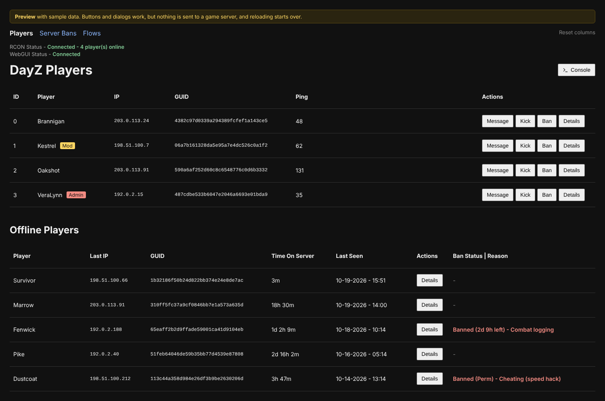
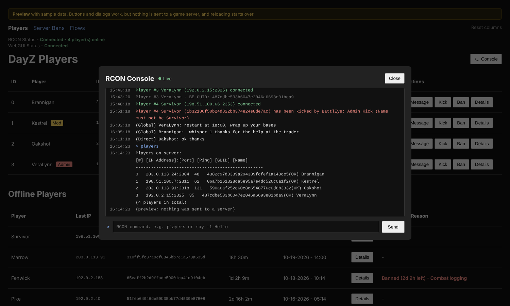
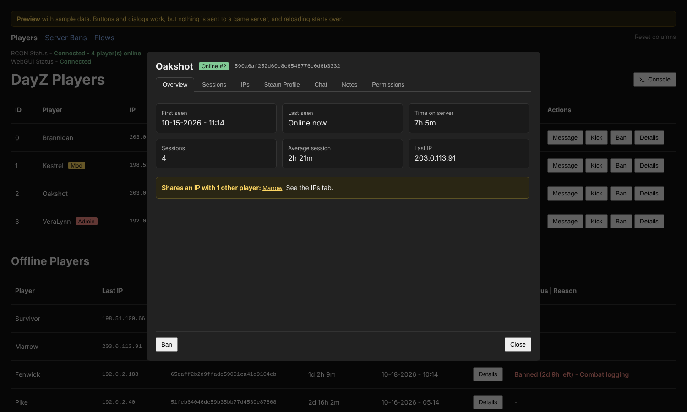
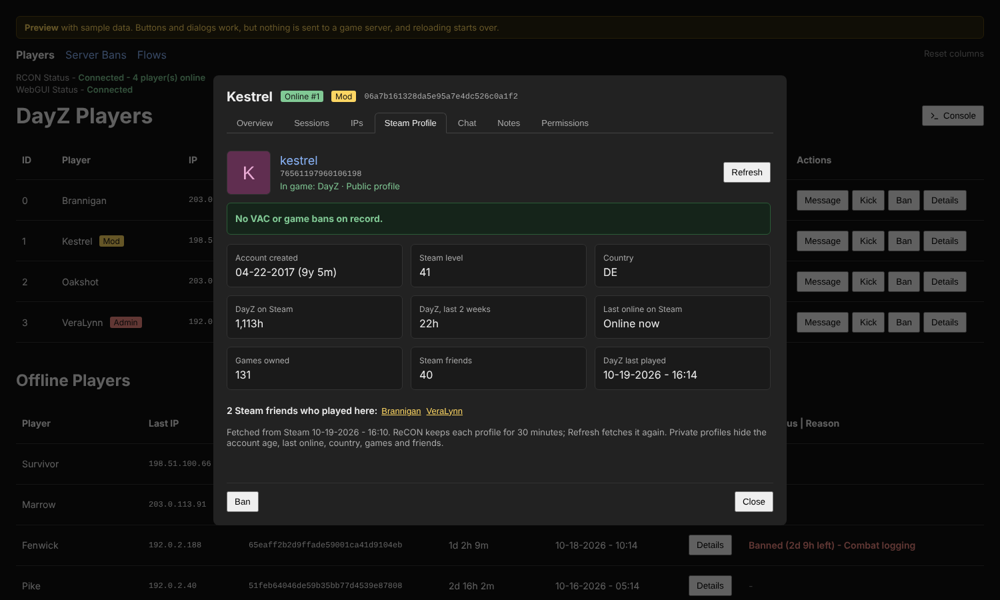
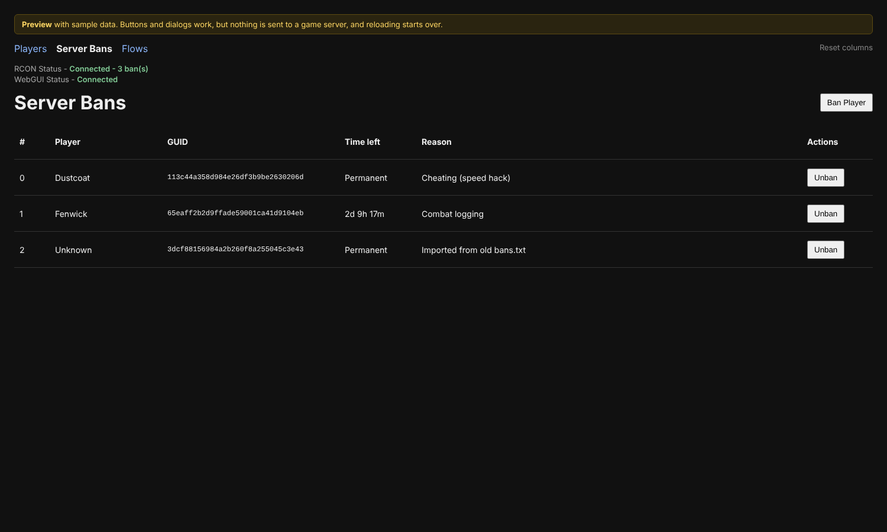
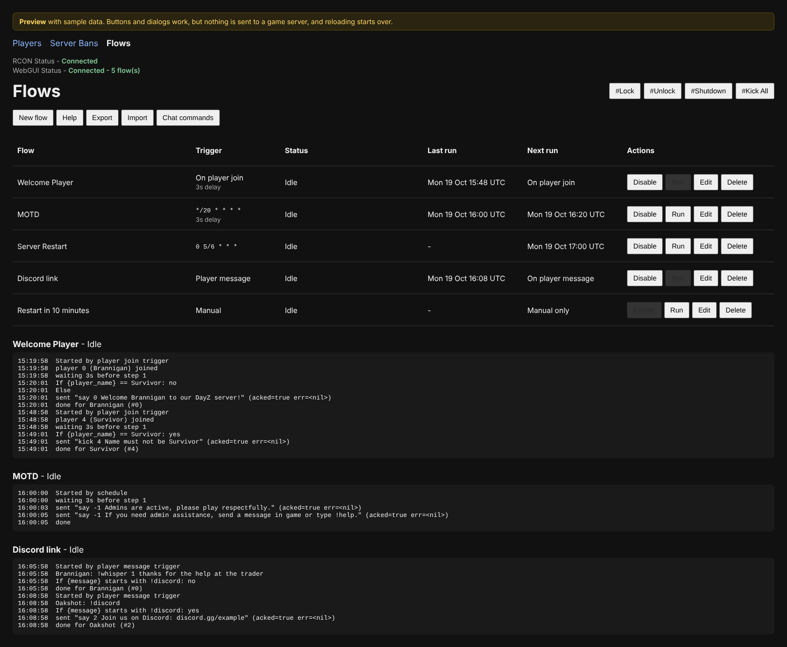
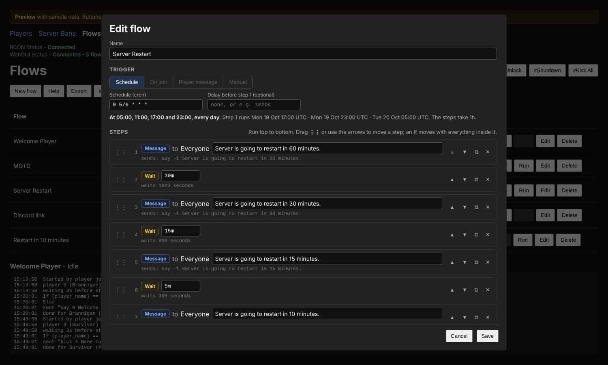
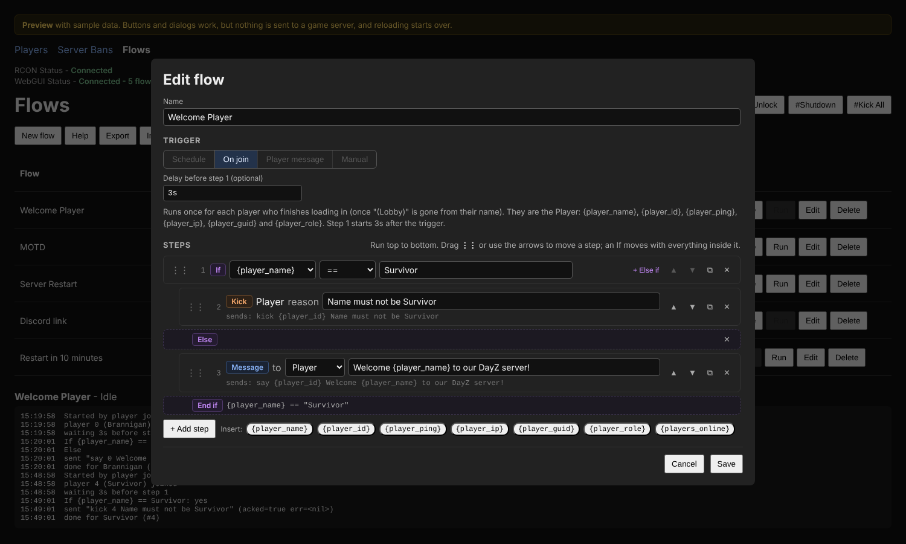
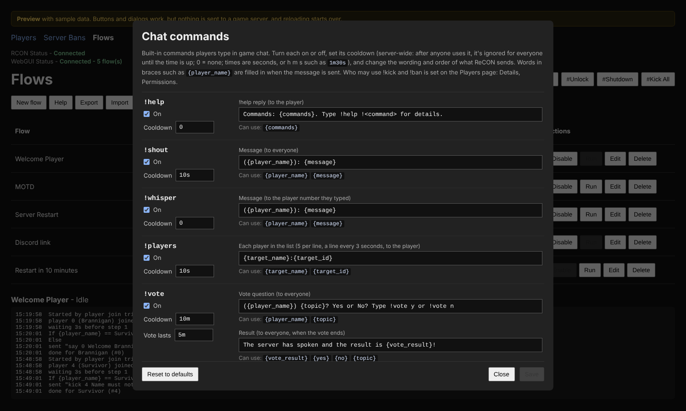
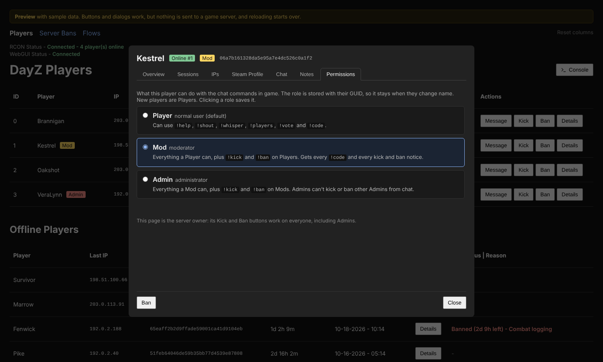

# ReCON

ReCON is a web admin panel for DayZ servers, built on BattlEye RCON. It runs in a small Docker container next to your game server and gives you:

- **A web GUI** for players, bans and automated flows: live player list, per-player history, Steam profiles, a live RCON console and a ban manager.
- **Flows**: restart countdowns, welcome messages, chat replies and more, built from steps in the browser, without writing any script.
- **In-game chat commands** such as `!help`, `!vote` and `!kick`, with Player, Mod and Admin roles.
- **An HTTP API** that any script or task scheduler can call, and a **command-line RCON tool** inside the container.



**Try it without a server:** [`docs/preview`](docs/preview/) has the real pages with sample data built in. Open `docs/preview/players.html` in a browser (from a downloaded copy of the repo, or wherever the `docs` folder is served). Every button and dialog works, but nothing is sent anywhere.

> **No authentication.** Anyone who can reach ReCON's port can run any RCON command on your server. Keep it on a trusted network or behind a reverse proxy with its own login, and never expose it directly to the internet.

## Contents

1. [Install and run](#1-install-and-run)
2. [Configuration](#2-configuration)
3. [The web GUI](#3-the-web-gui)
4. [Flows](#4-flows)
5. [Chat commands and roles](#5-chat-commands-and-roles)
6. [Steam profiles](#6-steam-profiles)
7. [Command line](#7-command-line)
8. [HTTP API](#8-http-api)
9. [Development](#9-development)

---

## 1. Install and run

### Requirements

- Docker with Docker Compose
- A DayZ server with BattlEye RCON turned on: `RConPassword` and `RConPort` set in `BEServer_x64.cfg`
- ReCON doesn't have to run on the same machine as the game server. It only needs to reach the RCON UDP port.

### docker-compose.yaml

Clone this repo, then put a `docker-compose.yaml` next to it (or use the one in the repo as a starting point):

```yaml
services:
  recon:
    container_name: recon
    build: ./recon                      # the folder this repo is cloned into
    restart: unless-stopped
    user: "${PUID:-1001}:${PGID:-1001}"
    environment:
      TZ: America/New_York
      RCON_HOST: 192.168.1.10           # Your DayZ Servers Local IP address
      RCON_PORT: "2305"                 # Your DayZ Server's RCON Port
      RCON_PASSWORD: ${RCON_PASSWORD}
      STEAM_API_KEY: ${STEAM_API_KEY}   # optional, see Steam profiles
      STEAM_SEARCH_MODE: "manual"
      STEAM_SEARCH_CORES: "2"
      STEAM_SEARCH_PRIORITY: "medium"
    volumes:
      - ./data:/data
    ports:
      - "8080:8080"
```

Put the secrets in `.env`, next to `docker-compose.yaml`:

```env
RCON_PASSWORD=your-rcon-password
STEAM_API_KEY=your-steam-web-api-key
```

### Build and start

```bash
docker compose up -d --build
docker logs -f recon
# listening on :8080 -> RCON 192.168.1.10:2305
# rcon: logged in, sent #unlock (acked=true err=<nil>)
```

Then open `http://<host>:8080` (it goes to the Players page).

### More than one DayZ server

Run one ReCON container per game server. Copy the service and give each copy its own service and container name, `RCON_PORT`, password, data folder and host port. Each container keeps its own database.

### Updating

The Go code is compiled into the image, so pull the new code and rebuild:

```bash
docker compose up -d --build
```

If it still seems to run the old code, force a clean build:

```bash
docker compose build --no-cache && docker compose up -d
```

---

## 2. Configuration

Everything is set with environment variables.

| Variable                | Default            | Description |
| ----------------------- | ------------------ | ----------- |
| `RCON_PASSWORD`         | none               | BattlEye RCON password. Needed unless you enter one in **Settings** on the Players page |
| `RCON_HOST`             | `127.0.0.1`        | IP or hostname of the DayZ server |
| `RCON_PORT`             | `2306`             | BattlEye RCON UDP port (`RConPort` in `BEServer_x64.cfg`) |
| `LISTEN_ADDR`           | `:8080`            | Address the web server listens on inside the container |
| `DB_PATH`               | `/data/players.db` | The SQLite database: players, sessions, IPs, chat, notes, roles, permanent bans, flows and settings (timed bans and RCON Settings are kept in memory only) |
| `TZ`                    | `UTC`              | Time zone for flow schedules and the times shown, e.g. `America/New_York` |
| `STEAM_API_KEY`         | none               | Turns on the full Steam Profile tab. Free at [steamcommunity.com/dev/apikey](https://steamcommunity.com/dev/apikey) |
| `STEAM_SEARCH_MODE`     | `manual`           | How SteamIDs the steam2guid table can't answer are searched for (the table, if you have one, is always read first, as soon as a player joins). `manual`: when you press **Search Steam ID**. `auto`: by itself, in one search for everyone waiting, starting 60s after the first join (+30s per join, at most 3 minutes or 15 players). Either way a search covers every player still missing a SteamID |
| `STEAM_SEARCH_CORES`    | `1`                | CPU cores a SteamID lookup may use (capped at the cores available) |
| `STEAM_SEARCH_PRIORITY` | `medium`           | How much of each core it uses: `low` 33%, `medium` 66%, `high` 99% |

`RCON_HOST`, `RCON_PORT` and `RCON_PASSWORD` are the defaults: **Settings** on the Players page can override any of them without editing `docker-compose.yaml` (see below).

Mount `/data` as a volume, or everything ReCON has recorded is lost when the container is recreated. The container runs as UID 99 / GID 100, so the data folder must be writable by that user.

---

## 3. The web GUI

Every page shows two status lines at the top:

- **RCON Status:** whether ReCON can reach the game server (a heartbeat every 5 seconds; three missed in a row means unavailable): *Connected*, or *Unavailable - Retrying...* with a small grey countdown to ReCON's next try. ReCON keeps retrying in the background on its own; after a few failed logins it waits longer between tries (up to 30 seconds).
- **WebGUI Status:** whether your browser can reach ReCON. While it can, the page's count follows *Connected*: players online, bans or flows.

On the Players and Server Bans pages you can drag table headers to reorder the columns; **Reset columns** puts them back.

### Players: `/players`

The top table lists the players online now (refreshed every 5 seconds). ReCON follows who connects and disconnects from the server's own messages; while this page is open it also asks the server for the player list every 5 seconds, for up-to-date pings. Mods and Admins have a badge after their name. **Last Message** shows the newest thing each player has written in chat since they connected (hover for the channel, time and full text). It's empty until they chat; messages sent to them aren't shown there, only in their chat history.

| Button  | What it does |
| ------- | ------------ |
| Message | Opens that player's conversation: their chat, the private messages ReCON sent them, and a box to send another |
| Kick    | Kicks them with the reason you type |
| Ban     | Bans their GUID for the minutes you enter (**0 = permanent**), then kicks them |
| Details | Opens everything ReCON has recorded about them (below) |

**Offline Players** lists everyone who has played before: last IP, total time on the server, when they were last seen, and their ban status and reason. If the game server stops answering, this list still shows from the database.

**Settings** (top right, above Console) changes where ReCON connects: Server IP, Port and RCON password. The line under the title shows the server in use: *Connected to IP:PORT* in green, or *Can't reach IP:PORT* in red. A field left empty uses the default from `docker-compose.yaml`, shown greyed out; clear the fields and Connect to go back to those defaults. **Connect** tries one login with those settings on a new connection each time it's pressed, even if nothing changed. Only if the server accepts the login does ReCON switch to it and keep the settings, so a typo can't cut ReCON off; otherwise nothing changes and the dialog says why. The settings are kept in memory only: restarting ReCON goes back to the `docker-compose.yaml` values, which the command-line tool always uses.

**Console** (top right) opens ReCON's console log: everything the server reports (connects, disconnects, GUIDs, chat, kicks, admin logins) and every command ReCON sends for the pages, flows and chat commands, with the server's reply, as it happens. Commands not typed in the console say who sent them. It runs any command you type exactly as typed; Up and Down recall earlier commands. ReCON keeps the last 50,000 lines until it restarts and shows the newest 1,000. The routine checks (heartbeats, player and ban list reads) aren't logged. The container log has the same lines, marked `[web]`; the command-line tool's are marked `[cli]` and aren't in the console.



#### Details

Details works for online and offline players. It has these tabs:

| Tab           | Shows |
| ------------- | ----- |
| Overview      | First and last seen, total time, sessions, average session, last IP, ban status, and a warning when the player shares an IP with anyone else |
| Sessions      | Each visit: connected, disconnected (noted when they were kicked or banned), duration and IP. A player back within 60 seconds of ReCON logging in again after a server restart keeps the same session; the time the server was down doesn't count |
| IPs           | Every IP they used, and anyone else seen on the same IP. Names are links to that player's details |
| Steam Profile | Their Steam account (see [Steam profiles](#6-steam-profiles)) |
| Chat          | Their chat history. While they're online you can message them from here |
| Notes         | A private admin note of up to 500 characters. It saves when you close the dialog or switch players |
| Permissions   | Their role for the chat commands: Player, Mod or Admin. Clicking a role saves it |

The **Ban** / **Unban** button at the bottom works whether the player is online or not.

| Overview | Steam Profile |
| :---: | :---: |
|  |  |

### Server Bans: `/bans`

Lists the server's GUID bans with the player's name, time left and reason, refreshed every 10 seconds. A GUID ReCON has never seen shows as *Unknown*. **Unban** removes every entry for that GUID and saves the ban file.

The list follows the server's ban list: ReCON reads it when it logs in to RCON (so after every server restart) and every 5 minutes. A ban added on the server some other way shows up at the next read. **Permanent** bans are stored in ReCON's database and only leave through **Unban** here: if one goes missing from the server's list, ReCON adds it back. **Timed** bans are kept in memory only, since the server already has them; a timed ban leaves the list when its time runs out, as it does on the server, and after ReCON restarts they come back with the first read.

**Ban Player** (top right) bans anyone who has ever played on the server, online or not. Pick them by name (online players are marked, and the start of the GUID tells apart players with the same name), enter a reason (the player sees it), and leave the duration at **0 for permanent** or enter minutes. An online player is kicked straight away.



### Flows: `/flows`

See [Flows](#4-flows) below. **Commands** (right of the buttons above the list) opens a dialog with **Lock server** (`#lock`), **Unlock server** (`#unlock`), **Kick everyone** (`kickall`) and **Shut down server** (`#shutdown`). Picking one sends it straight away, and the result shows just above the button. Kick everyone and Shut down ask you to confirm first.

---

## 4. Flows

A flow is a list of steps ReCON runs for you: send a message, wait, lock the server, kick a player, and so on. Steps run from the top down. Only **Wait** takes time; everything else goes out straight away.



| Button           | What it does |
| ---------------- | ------------ |
| Enable / Disable | Turns the trigger on or off. Schedule, On join and Player message flows start disabled |
| Run / Stop       | Starts a Schedule or Manual flow now, or stops a running one |
| Edit             | Opens the flow editor |
| Delete           | Deletes the flow (stop it first). This is the only action that asks first |
| New flow         | Creates a flow |
| Help             | The full guide: steps, placeholders, If / Else, triggers, cron and chat commands |
| Export / Import  | Download every flow as `flows.json`, or add flows from a file: Import lists the file's flows with a checkbox each (and **Select all**), and only the ticked ones are added, at the bottom, disabled |
| Chat commands    | The [chat command settings](#5-chat-commands-and-roles) |

Drag rows to reorder the list. Each flow's latest run log is shown under the table: every message sent, every If decision, and how the run ended.

### Triggers

| Trigger            | Runs | Needs Enable |
| ------------------ | ---- | ------------ |
| **Schedule**       | On a cron schedule | Yes |
| **On join**        | Once for each player who connects, as soon as they finish loading in | Yes |
| **Player message** | Once for every chat message a player sends, as soon as it arrives | Yes |
| **Manual**         | When you press Run, or call `POST /api/flows/<id>/run` | No |

- Every trigger can have a **delay** before step 1.
- A flow's trigger can't change after it's saved, so a restart flow can never start firing on every join by accident. To change it, make a new flow, or Export, edit `trigger` in the file and Import.
- On join and Player message flows run for one player (who joined, or who typed), so Run can't start them. Several players can be in progress at once; they share one run log and one Stop button.
- Schedules start right on time (plus the delay): ReCON watches the clock rather than checking every few seconds.
- On join flows start for players ReCON sees connecting: ReCON asks the server for the player list every 5 seconds while someone is loading, and the flow starts when *(Lobby)* leaves their name. Players already online when ReCON starts aren't greeted. After a server restart, everyone who reconnects is.

### Times

Every time box (Wait, the delay, chat command cooldowns) takes seconds, or hours, minutes and seconds together: `30`, `90s`, `1m20s`, `2h 15m`.

### Steps



| Step                             | Sends |
| -------------------------------- | ----- |
| Message                          | `say -1 text` to Everyone, or `say <number> text` to the Player |
| Player list                      | The names of everyone online |
| Wait                             | Nothing: pauses before the next step |
| Lock / Unlock / Shut down server | `#lock`, `#unlock`, `#shutdown` |
| Kick / Ban                       | Kicks or bans (by GUID) the Player |
| Kick everyone                    | Kicks every player online |
| If                               | Runs its steps only when its condition is true |
| For each                         | Runs the steps inside it once per player online, or per new chat message, with that player as the Player (see below) |
| Stop flow                        | Ends the run there |
| RCON command                     | Any command, as typed |

Move a step with its arrows, or drag it by the `⋮⋮` handle. Moving an If moves everything inside it. Anything missing is shown in red under the row.

**When stopped:** Schedule and Manual flows can also have steps that are sent if someone presses Stop before the run ends, such as *Server restart cancelled.* and Unlock server.

### Placeholders

Click a placeholder under the steps to insert it into the text box you were typing in. It's filled in when the step runs.

| Placeholder | Is | Works in |
| ----------- | -- | -------- |
| `{players_online}` | How many players are online | Every flow |
| `{player_name}` `{player_id}` | The player's name and number | On join, Player message |
| `{player_ping}` `{player_ip}` `{player_guid}` | Their ping, IP address and GUID | On join, Player message |
| `{player_role}` | Player, Mod or Admin | On join, Player message |
| `{message}` | Everything they typed | Player message |

### If, Else if, Else

An If compares one thing, such as `{player_ping}`, and runs its steps when the comparison is true. **+ Else if** adds more comparisons of the same thing; the first one that's true runs. **+ Else** runs when none are. Ifs can go inside other Ifs.

| Compare | Operators |
| ------- | --------- |
| `{message}` | **contains** any of the words, or a `"quoted phrase"`, as whole words. **starts with**: the first word is one of the words, so `!discord` matches "!discord please" but not "!discordx". **is exactly**: the whole message is the value. Case is ignored |
| `{player_name}` `{player_ip}` | **is** / **is not** ignoring case, **matches** with `*` wildcards (`*admin*`, `192.168.*`), or **contains** |
| `{player_id}` `{player_guid}` | **is** / **is not** |
| `{player_ping}` `{players_online}` | `=` `!=` `>` `>=` `<` `<=` |
| `{player_role}` | **is**, **is not**, **is at least** or **is at most** Player, Mod or Admin (Player < Mod < Admin) |



### For each

**For each** runs the steps inside it (down to its *End for each*) once per item, with that item's player as the Player. Kick, Ban, a Message to the Player, the `{player_...}` placeholders, `{message}` and If comparisons all work inside it, in any trigger, Schedule and Manual included. Ifs inside decide who or what qualifies, and it acts only when the flow runs, on what happened since the flow's last run (the first run looks at the current sessions so far). Pick what it goes through:

- **player**: every player online (the latest 5-second player check's), one after another. `{message}` is that player's latest chat line since this flow last ran (empty if they haven't chatted since).
- **message**: every chat line that players online sent since this flow last ran, oldest first, with the sender as the Player and the line as `{message}`. A flow every minute sees each line once.

Other rules:

- **Unverified players:** players BattlEye hasn't verified yet are left out.
- **Stop flow** inside it ends the whole run.
- **No nesting:** a For each can't go inside another one.
- **Run log:** lists each player a condition matched, not every one checked.

Chat lines are kept in memory with each online player for their current session (up to 100 each), so they go when the player leaves or ReCON restarts.

For example, Schedule flows every minute (`* * * * *`):

```
For each player
    If {player_ping} > 500
        Kick  the Player, reason "Ping too high ({player_ping})"
    End if
End for each

For each message
    If {message} contains noob
        Message  the Player "Please keep chat friendly"
    End if
End for each
```

In a flow without a player of its own, **Add step** puts an If inside the For each at the end of the list, and Kick, Ban and Message into the innermost block there, so New flow → Schedule → Add step *For each*, *If*, *Kick* builds the first one.

Some examples:

- Schedule: **If** `{players_online} > 0` Kick everyone, **Else** Shut down server.
- On join: **If** `{player_ping} >= 500` Kick, reason *Ping too high ({player_ping})*.
- Player message: **If** `{message}` starts with `!discord`, Message to Player *Join us at discord.gg/...*.

### Schedules

A schedule is a standard 5-field cron expression, `minute hour day-of-month month day-of-week`, in the container's `TZ`. As you type, the editor explains it in plain English and lists the next runs, delay included.

| Cron           | Runs |
| -------------- | ---- |
| `0 6 * * *`    | Every day at 06:00 |
| `0 */6 * * *`  | 00:00, 06:00, 12:00 and 18:00 |
| `0 5/6 * * *`  | 05:00, 11:00, 17:00 and 23:00 |
| `30 4 * * 1,4` | Mondays and Thursdays at 04:30 |
| `0 5 * * 1-5`  | Weekdays at 05:00 |

`*` is any value, `1,4` a list, `1-5` a range and `*/15` every 15th. Months and weekdays also accept names (`jan`-`dec`, `sun`-`sat`); Sunday is 0 or 7.

Whenever ReCON logs in to the game server (on start, and after a server restart), it sends `#unlock`. A restart flow can therefore lock the server, shut it down and leave the unlock to ReCON.

### Example flows

[`examples/flows.json`](examples/flows.json) has three ready-made flows to Import: a **Welcome Player** greeting (which also kicks anyone still named *Survivor*), an **MOTD** every 20 minutes, and a **Server Restart** countdown with warnings from 60 minutes out. The file format is the same as Export's:

```json
{
  "flows": [
    {
      "name": "MOTD",
      "trigger": "schedule",
      "schedule": "*/20 * * * *",
      "delay": "3s",
      "steps": [
        { "type": "message", "to": "all", "text": "Admins are active, please play respectfully." },
        { "type": "wait", "time": "2s" },
        { "type": "message", "to": "all", "text": "If you need admin assistance, send a message in game or type !help." }
      ]
    }
  ]
}
```

---

## 5. Chat commands and roles

Players type these in game chat. They start with `!` because DayZ drops chat messages that start with `/`.

| Command | Who | Does |
| ------- | --- | ---- |
| `!help` | Everyone | Lists the commands; `!help !vote` explains one |
| `!shout <message>` | Everyone | Sends the message to everyone |
| `!whisper <number> <message>` | Everyone | Private message to that player |
| `!players` | Everyone | Lists everyone online with their number |
| `!vote <question>` | Everyone | Starts a server-wide vote; everyone answers `!vote y` or `!vote n`, and more yes than no passes |
| `!code` | Everyone | Sends the player's code (the last 6 characters of their GUID) to the mods and admins online |
| `!kick <code> <reason>` | Mods, Admins | Kicks that player |
| `!ban <code> <reason>` | Mods, Admins | Bans that player permanently, even if they've left |

- **Roles** are set on the Players page, under **Details → Permissions**, and are stored with the player's GUID, so they survive a name change. New players are Players.
- Mods can kick and ban Players. Admins can also kick and ban Mods. Nobody can kick or ban an Admin from chat. The web GUI's buttons act as the server owner and work on everyone.
- Every mod and admin online is told about each kick and ban. With **Announce** on, everyone is told.
- Only a command that works gets a reply. A typo, a cooldown or a missing permission is silently ignored, though the line still appears in the player's chat history.

**Chat commands** on the Flows page turns each command on or off, sets its cooldown and edits the wording of everything ReCON sends. Cooldowns are server-wide: once anyone uses a command, it's ignored for everyone until the time is up.

| Chat command settings | Permissions |
| :---: | :---: |
|  |  |

---

## 6. Steam profiles

BattlEye only reports a GUID, which is a one-way hash of the player's SteamID. ReCON finds the SteamID by checking Steam account IDs until one matches the GUID. Older accounts are found in seconds; newer ones take longer. Once found, the SteamID is saved with the player, so the lookup only happens once.

- When a player without a SteamID joins, ReCON looks them up in a steam2guid table straight away, if you have one. Anyone it can't answer needs a search, which covers every player still missing a SteamID at once. In the default `manual` mode it starts from the **Search Steam ID** button on a player's Steam Profile tab, which shows its progress. In `auto` mode it starts by itself, a minute after the first such player joins (30 seconds more for each further join, at most 3 minutes or 15 players).
- `STEAM_SEARCH_CORES` and `STEAM_SEARCH_PRIORITY` set how much CPU a lookup may use.

Without `STEAM_API_KEY`, the tab shows only the SteamID and a link to the profile. With a key it also shows:

- VAC and game bans (from any game), community and trade bans
- account age, Steam level, country, and when they were last online
- DayZ hours (total and the last two weeks), and a warning when DayZ isn't in their library, which can mean they're playing on a Family Sharing copy
- games owned, friend count, and which of their Steam friends have played on your server

Profiles are kept for 30 minutes; **Refresh** fetches one again. Private profiles hide most of these.

---

## 7. Command line

The image includes a command-line RCON tool, `recon` (also available as `rcon`). It logs in with the container's settings.

```bash
docker exec recon recon players
docker exec recon recon say -1 "Hello everyone"
docker exec recon recon "#lock"
docker exec recon recon kickall "Server restarting"
```

Interactive mode stays logged in until you type `exit`:

```bash
docker exec -it recon recon -i
rcon> players
rcon> say -1 Restart in 5 minutes
rcon> exit
```

Quote anything that starts with `#`, or the shell treats it as a comment. Use single quotes around messages that contain `!`.

### Common RCON commands

| Command | Effect |
| ------- | ------ |
| `players` | List connected players |
| `say -1 <message>` | Message everyone |
| `say <player#> <message>` | Message one player |
| `kick <player#> <reason>` | Kick one player |
| `bans` | List bans |
| `addBan <guid> <minutes> <reason>` | Ban a GUID (0 = permanent) |
| `removeBan <#>` | Remove a ban by its number in `bans` |
| `#lock` / `#unlock` | Block or allow new connections |
| `#shutdown` | Stop the server |
| `kickall [reason]` | ReCON's own command: kick everyone online |

---

## 8. HTTP API

Every response is JSON. Failed requests return `{"ok": false, "error": "..."}`. The examples use `http://<host>:8080`.

### Run any RCON command

```bash
curl "http://<host>:8080/rcon?cmd=players"                       # GET, URL-encoded

curl -X POST http://<host>:8080/rcon \
  -H "Content-Type: application/json" \
  -d '{"command":"say -1 Restart in 5 minutes"}'                 # POST, JSON

curl -X POST http://<host>:8080/rcon -d '#lock'                  # POST, plain text
```

```json
{"ok": true, "command": "players", "acked": true, "output": "Players on server: ..."}
```

`acked: false` means the server never confirmed it received the command.

### Kick everyone

`POST /kickall` with an optional `{"reason": "..."}` (default `Server restarting`). The `result` lists who was kicked (`order`), kicks the server didn't acknowledge (`unacked`) and anyone still connected (`remaining`).

### Players

| Method | Path | Body | Description |
| ------ | ---- | ---- | ----------- |
| GET  | `/api/players` | | Online players, offline players and ban statuses |
| GET  | `/api/players/all` | | Every player ever seen, from the database (works while RCON is down) |
| POST | `/api/players/<id>/message` | `{"message": "..."}` | Private message, by player number |
| POST | `/api/players/<id>/kick` | `{"reason": "..."}` | Kick, by player number |
| POST | `/api/players/<id>/ban` | `{"reason": "...", "minutes": 0}` | Ban by GUID (0 = permanent) and kick, by player number |
| GET  | `/api/players/<guid>/details` | | Everything the Details dialog shows |
| GET  | `/api/players/<guid>/chat` | | Chat history, oldest first |
| POST | `/api/players/<guid>/chat` | `{"message": "..."}` | Private message, by GUID |
| POST | `/api/players/<guid>/note` | `{"note": "..."}` | Save the admin note (an empty note deletes it) |
| POST | `/api/players/<guid>/role` | `{"role": 0}` | 0 Player, 1 Mod, 2 Admin |
| GET  | `/api/players/<guid>/steam` | | The Steam Profile tab; `?refresh=1` fetches it again |
| POST | `/api/players/<guid>/steam/search` | | Start looking up the player's SteamID |

`<id>` is the player number from the `players` command. It's reused when a player leaves, so the GUID routes are safer for scripts.

### Bans

| Method | Path | Body | Description |
| ------ | ---- | ---- | ----------- |
| GET  | `/api/bans` | | The GUID bans |
| POST | `/api/bans/<guid>/ban` | `{"reason": "...", "minutes": 0}` (optional) | Ban any player ReCON has seen, online or not. Online players are kicked too |
| POST | `/api/bans/<guid>/unban` | | Remove every ban for that GUID |

### Console

| Method | Path | Body | Description |
| ------ | ---- | ---- | ----------- |
| GET  | `/api/rcon-settings` | | The RCON overrides in use (memory only), the `docker-compose.yaml` defaults and the address in use |
| POST | `/api/rcon-settings` | `{"host": "...", "port": "...", "password": "..."}` | One login with these (empty = default); if accepted, switch to it and save them |
| GET  | `/api/console?after=N` | | Server messages and console commands newer than `N`, plus `last` to pass next time |
| POST | `/api/console` | `{"command": "..."}` | Run a command exactly as typed and add it to the console log |

### Flows

| Method | Path | Body | Description |
| ------ | ---- | ---- | ----------- |
| GET  | `/api/flows` | | Every flow with its next and last run, and each flow's latest run log |
| POST | `/api/flows` | `{"id", "name", "trigger", "schedule", "delay", "steps", "onStop"}` | Update flow `id`, or create a flow when `id` is left out (or `null`). `0` is an ordinary flow number |
| POST | `/api/flows/<id>/run` | `{"minutes": N}` (optional) | Run now. `minutes` replaces the flow's delay for this run |
| POST | `/api/flows/<id>/stop` | | Stop a running flow |
| POST | `/api/flows/<id>/enable` | | Turn the trigger on |
| POST | `/api/flows/<id>/disable` | | Turn the trigger off |
| POST | `/api/flows/<id>/delete` | | Delete a flow |
| GET  | `/api/flows/export` | | Download `flows.json` |
| POST | `/api/flows/import` | `{"flows": [...]}` | Add flows from an export |
| POST | `/api/flows/command` | `{"command": "lock"}` | `lock`, `unlock`, `shutdown` or `kickall` |
| GET  | `/api/chat-commands` | | Chat command settings and defaults |
| POST | `/api/chat-commands` | `{"settings": {...}}` | Save chat command settings |

A flow's `<id>` is its number, shown as *Flow #N* next to the title when you edit it. Numbers start at 0, and a flow keeps its number for as long as it exists. A new flow gets the lowest free number, so deleting flows frees their numbers for the next ones: four flows deleted and four created are 0-3 again, not 4-7.

For example, to start a manual restart flow with a 10-minute delay from a script:

```bash
curl -X POST http://<host>:8080/api/flows/3/run \
  -H "Content-Type: application/json" -d '{"minutes":10}'
```

### Status

`GET /health` returns `{"ok": true}`. `GET /api/status` returns the RCON state the pages show: `{"ok": true, "rcon": "connected"}` (or `retrying` / `unavailable`).

### From a task scheduler

Any tool with a "POST to a URI" action can call these routes. For example: URI `http://<host>:8080/kickall`, content type `application/json`, payload `{"reason":"Restarting now"}`. For a full restart sequence, a Schedule or Manual flow is usually simpler.

---

## 9. Development

ReCON is a single Go program with no dependencies besides the SQLite driver.

| File | Contents |
| ---- | -------- |
| `main.go` | Startup, configuration and the command-line tool |
| `rcon.go` | The BattlEye RCON protocol, the shared session, the heartbeat and polls, and the console log |
| `web.go` | HTTP routes, the JSON API and page rendering |
| `db.go` | SQLite storage, the ban list sync and the chat recorder |
| `players.go` | Who is online and their sessions, from the console log; keeps a session across a server restart for players back within 60 seconds |
| `flows.go` | Flows (steps, conditions, runner) and the chat commands |
| `flows_schedule.go`, `flows_join.go`, `flows_message.go`, `flows_manual.go` | One file per flow trigger |
| `steam.go` | SteamID lookups and Steam profiles |
| `templates/` | The HTML pages, embedded into the binary at build time |
| `examples/flows.json` | Example flows to import |
| `docs/preview/` | The static preview pages |
| `docs/screenshots/` | The images in this README |

### Rebuilding the preview

The preview pages are generated from the real templates, so they never drift from the app:

```bash
RECON_PREVIEW=1 go test -run TestPreview .
```

This rewrites `docs/preview/players.html`, `bans.html`, `flows.html` and `data.js`. The sample players, bans and flows, and the stand-in for the API, are in `docs/preview/preview.js`. A plain `go test` skips this test.

## License

[MIT](LICENSE)
