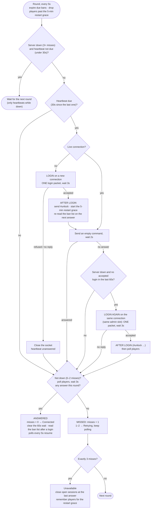

# RCON login after a server shutdown or restart

How ReCON's web session (`internal/rcon`, driven by `internal/watch`) notices the game server has gone away and
logs in again when it comes back. Everything here is done by the **server
watch**, which runs one round every 5 seconds, starting when ReCON starts.

The rules that shape it:

- **Only the heartbeat logs in**, at most **one login packet every 30 seconds**.
  Page actions, flow steps and polls never log in; while ReCON isn't logged in
  they fail straight away with "not logged in to RCON".
- A restarting server can accept packets on its port before BattlEye answers
  them, then handle the whole backlog at once: every login sent in that time
  becomes another "RCon admin logged in". One login per heartbeat keeps that to
  a minimum.
- After a login is accepted, ReCON doesn't log in again for **60 seconds** while
  waiting for the server to start answering commands.

## Flow chart

## Example: `#shutdown` and restart

| When | Game server | ReCON |
|---|---|---|
| 0s | Gets `#shutdown`, process exits | Sends the command once (`acked` may be false: the server can die before replying). Players' disconnect lines close their sessions. |
| +5s, +10s | Down | `players` polls get no answer (or fail at once if the connection died): misses 1 and 2, status **Retrying**. |
| +15s | Down | Miss 3: status **Unavailable**. Sessions still open are closed at the time the server last answered; those players are remembered for the restart grace. No login is sent. |
| Every 30s | Port closed, then open but BattlEye still starting | One heartbeat per 30s, each with **one** login packet: refused at once while the port is closed, or no reply within 3s while BattlEye is starting. |
| Next heartbeat | BattlEye answering | Login accepted: `> #unlock` in the console, the 5-minute restart grace starts. The empty command or `players` poll is answered: status **Connected**, the ban list is read, polls every 5s resume. |
| Within 5 minutes | Players reconnecting | A player back **from the same IP** keeps the session they had; the time the server was down isn't counted. From a new IP, they get a new session. |

If BattlEye accepts the login but doesn't answer commands yet (still loading
the map), ReCON doesn't log in again for 60 seconds and keeps sending a
heartbeat every 30 seconds until one is answered.

BattlEye may report ReCON's login late, after the map has loaded, in a burst
with its `Config entry` lines. That is the same login (same port), not a second
one.

## Timings

| Setting | Value | In the code |
|---|---|---|
| Round (`players` poll while answering) | 5s | `pollEvery` (`internal/watch`) |
| Heartbeat (and the only login) | 30s | `heartbeatEvery` (`internal/watch`) |
| Wait for a heartbeat's answer | 2s | `heartbeatWait` (`internal/watch`) |
| Wait for a `players` reply | 3s | `PollWait` (`internal/players`) |
| Wait for a login reply | 3s | `ReloginReplyWait` (`internal/battleye`) |
| Misses before **Unavailable** | 3 | `DownAfterMisses` (`internal/rcon`) |
| No new login after an accepted one | 60s | `ReloginSettle` (`internal/rcon`) |
| Restart grace (players keep their session) | 5 min | `restartGrace` (`internal/players`) |
