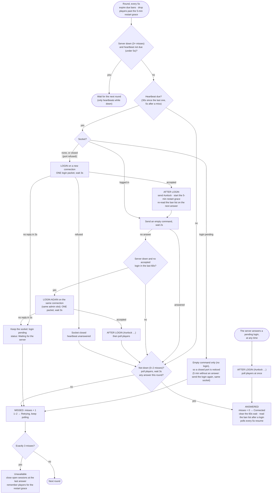

# RCON login after a server shutdown or restart

How ReCON's web session (`internal/game`: `session.go`, driven by the server
watch in the same file) notices the game server has gone away and logs in
again when it comes back. Everything here is done by the **server watch**,
which runs one round every 5 seconds, starting when ReCON starts.

The rules that shape it:

- **One login, then wait for its answer.** A restarting server opens its RCON
  port before BattlEye answers, takes the login packets sent meanwhile, and
  answers them all once BattlEye is up: every one becomes another
  "RCon admin logged in", and one sent on a socket ReCON has since closed
  leaves an admin slot behind. So ReCON sends one login and keeps that socket
  open, however long the answer takes. No other login is sent while it waits.
- **A login is only lost when the server refuses it.** While the game server
  is down its port is closed, and the system reports every packet sent there
  as refused; that closes the socket, and the next heartbeat logs in on a new
  one. A refused login is never answered later, so it leaves nothing behind.
- **Only the heartbeat logs in**: every 30 seconds while the server answers,
  every 5 seconds once a check has gone unanswered. Page actions,
  flow steps and polls never log in; while ReCON isn't logged in they fail
  straight away with "not logged in to RCON".
- **The answer is taken as soon as it comes**: ReCON sends `#unlock` 3
  seconds later (after the server's "RCon admin … logged in" line), reads
  the player list and shows **Connected** without waiting for the next round.

What a DayZ server did after `#shutdown`, measured from ReCON's machine:

| After `#shutdown` | Game server |
|---|---|
| 0s | Acknowledges `#shutdown`, then exits |
| about 5s to 33s | Port closed: every packet is refused at once |
| from about 35s | Port open, nothing answered (BattlEye still starting) |
| about 72s | BattlEye answers the login sent at 35s (37s later) and announces it as "RCon admin #0 (…) logged in" |
| a few seconds later | Commands answered; a local client on the server (127.0.0.1) logs in too |

A login sent in the silent stretch is answered at about 72s whether it went
on a new socket or on the one ReCON was already logged in on. After it,
commands start again at sequence number 0.

## Flow chart

## Example: `#shutdown` and restart

| When | Game server | ReCON |
|---|---|---|
| 0s | Gets `#shutdown`, process exits | Sends the command once (`acked` may be false: the server can die before replying). Players' disconnect lines close their sessions. |
| +5s, +10s | Down, port closed | `players` polls fail (the port refuses them and the socket closes): misses 1 and 2, status **Retrying**. |
| +15s | Down | Miss 3: status **Unavailable**. Sessions still open are closed at the time the server last answered; those players are remembered for the restart grace. |
| Every 5s | Port closed | The heartbeat's one login is refused at once; nothing is left behind. |
| First heartbeat with the port open | BattlEye still starting | One login, no answer within 3s: the socket is kept and the login is pending. Status **Connecting - Waiting for the server...** in yellow, no countdown. Later heartbeats send only an empty command. |
| When BattlEye is up | Answers the login | Login accepted: `> #unlock` in the console, the 5-minute restart grace starts, `players` is read at once: status **Connected**, the ban list is read, polls every 5s resume. |
| Within 5 minutes | Players reconnecting | A player back **from the same IP** keeps the session they had; the time the server was down isn't counted. From a new IP, they get a new session. |

If the port closes again while the login is pending (the server went down
again), the next heartbeat's empty command is refused and closes the socket,
and the heartbeat after that logs in on a new one. If no answer comes for 5
minutes (the packet itself was lost), the login is sent again on the same
socket.

If BattlEye accepts the login but doesn't answer commands yet (still loading
the map), ReCON doesn't log in again for 60 seconds and keeps sending a
heartbeat every 5 seconds until one is answered.

BattlEye may report ReCON's login late, after the map has loaded, in a burst
with its `Config entry` lines. That is the same login (same port), not a second
one.

## Timings

| Setting | Value | In the code |
|---|---|---|
| Round (`players` poll while answering) | 5s | `pollEvery` (`internal/game`) |
| Heartbeat (and the only login) | 30s | `heartbeatEvery` (`internal/game`) |
| Heartbeat after an unanswered check, until one is answered | 5s | `retryHeartbeatEvery` (`internal/game`) |
| Wait for a heartbeat's answer | 2s | `heartbeatWait` (`internal/game`) |
| Wait for a `players` reply | 3s | `PlayersPollWait` (`internal/game`) |
| Wait for a login reply before it counts as pending | 3s | `ReloginReplyWait` (`internal/battleye`) |
| A pending login is sent again (same socket) after | 5 min | `LoginResendAfter` (`internal/game`) |
| Misses before **Unavailable** | 3 | `DownAfterMisses` (`internal/game`) |
| No new login after an accepted one | 60s | `ReloginSettle` (`internal/game`) |
| Restart grace (players keep their session) | 5 min | `restartGrace` (`internal/game`) |
